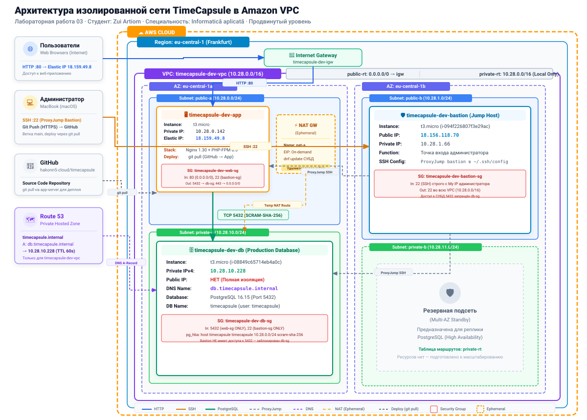

# Отчёт по лабораторной работе №3
## Тема: Облачные сети. Amazon VPC

---

### Сведения о студенте и проекте
- **ФИО:** Zui Artiom
- **Группа:** IA2403
- **Специальность:** Informatică aplicată
- **Порядковый номер ($k$):** 28 ($X = 28 \pmod{30} = 28$)
- **Уровень выполнения:** Продвинутый (Advanced, оценка 10/10)
- **Выбранное приложение:** TimeCapsule (`open_capsules_php_functional` — процедурный PHP, PostgreSQL 16, Nginx, PHP-FPM)
- **Репозиторий на GitHub:** [https://github.com/hakonn5-cloud/timecapsule](https://github.com/hakonn5-cloud/timecapsule)
- **Регион AWS:** `eu-central-1` (Frankfurt)
- **Архитектурное решение (ADR):** [docs/adr/0002-database-placement.md](../adr/0002-database-placement.md)

---

## 1. Архитектура сети лабораторной работы

### 1.1. Архитектурная схема
  
*Рисунок 0. Архитектурная схема изолированной сети TimeCapsule в Amazon VPC.*

### 1.2. Описание компонентов сети
- **Amazon VPC (`timecapsule-dev-vpc`):** Изолированная виртуальная сеть с адресным пространством `10.28.0.0/16` (65 536 адресов) в регионе `eu-central-1` (Франкфурт).
- **Подсети (Subnets):** Разделены по двум зонам доступности (`eu-central-1a` и `eu-central-1b`):
  - `timecapsule-dev-public-a` (`10.28.0.0/24`) — публичная подсеть для веб-сервера / сервера приложений (`app-server`).
  - `timecapsule-dev-public-b` (`10.28.1.0/24`) — публичная подсеть для сервера управления (`bastion`).
  - `timecapsule-dev-private-a` (`10.28.10.0/24`) — изолированная приватная подсеть для сервера СУБД (`db-server`).
  - `timecapsule-dev-private-b` (`10.28.11.0/24`) — резервная приватная подсеть.
- **Шлюзы и маршрутизация:**
  - `timecapsule-dev-igw` — Internet Gateway для связи публичных подсетей с интернетом.
  - `timecapsule-dev-public-rt` — таблица маршрутизации с маршрутом по умолчанию `0.0.0.0/0` через IGW.
  - `timecapsule-dev-private-rt` — изолированная таблица маршрутизации (только локальный маршрут `10.28.0.0/16 local`).
  - `timecapsule-dev-nat-a` — временный NAT Gateway в `public-a` (создаётся только на период установки пакетов и обновлений).
- **Безопасность (Security Groups):**
  - `bastion-sg`: доступ по SSH (порт 22) только с доверенного IP администратора.
  - `web-sg`: доступ по HTTP (порт 80) отовсюду (`0.0.0.0/0`), SSH (порт 22) только из `bastion-sg`.
  - `db-sg`: доступ к PostgreSQL (порт 5432) только из `web-sg`, SSH (порт 22) только из `bastion-sg`.
- **DNS (Route 53):** Private Hosted Zone `timecapsule.internal`, разрешающая имя `db.timecapsule.internal` в приватный IP СУБД.

---

## 2. Практическая часть: выполнение заданий и скриншоты

### 2.1. Базовый уровень (Часть 1)

#### Задание 1. План адресов

Расчет параметра $X$:
$$k = 28 \implies X = 28 \pmod{30} = 28$$

Диапазон всей VPC: **`10.28.0.0/16`**

| Подсеть | Зона доступности | Диапазон CIDR | Первый и последний адрес, доступный экземплярам | Сколько адресов доступно экземплярам |
| :--- | :--- | :--- | :--- | :--- |
| `public-a` | `eu-central-1a` | `10.28.0.0/24` | `10.28.0.4` – `10.28.0.254` | 251 |
| `public-b` | `eu-central-1b` | `10.28.1.0/24` | `10.28.1.4` – `10.28.1.254` | 251 |
| `private-a` | `eu-central-1a` | `10.28.10.0/24` | `10.28.10.4` – `10.28.10.254` | 251 |
| `private-b` | `eu-central-1b` | `10.28.11.0/24` | `10.28.11.4` – `10.28.11.254` | 251 |

**Ответы на вопросы Задания 1:**
1. *Почему доступных адресов не 256? Какие адреса подсети занимает AWS и для чего?*
   В подсети `/24` физически существует $2^8 = 256$ адресов. AWS резервирует первые 4 адреса и 1 последний адрес под служебные нужды облачной инфраструктуры ($256 - 5 = 251$):
   - `10.28.0.0` — Сетевой адрес (Network address).
   - `10.28.0.1` — Виртуальный маршрутизатор VPC (VPC router).
   - `10.28.0.2` — DNS-сервер VPC (AmazonProvidedDNS).
   - `10.28.0.3` — Зарезервирован AWS для будущего расширения функционала.
   - `10.28.0.255` — Широковещательный адрес (Network broadcast address; не поддерживается в VPC, но зарезервирован).
2. *Сколько ещё подсетей `/24` поместится в вашу VPC?*
   В сети `/16` содержится $2^{24 - 16} = 256$ подсетей `/24`. Мы создали 4 подсети, следовательно, в VPC может поместиться ещё $256 - 4 = 252$ дополнительные подсети `/24`.

---
#### Задание 2. VPC и подсети

Была вручную создана VPC `timecapsule-dev-vpc` с блоком CIDR `10.28.0.0/16`. В свойствах VPC активированы опции `Enable DNS resolution` и `Enable DNS hostnames`. Внутри VPC созданы 4 подсети: две публичные (`timecapsule-dev-public-a` в `eu-central-1a`, `timecapsule-dev-public-b` в `eu-central-1b`) и две приватные (`timecapsule-dev-private-a` в `eu-central-1a`, `timecapsule-dev-private-b` в `eu-central-1b`). Все ресурсы размечены обязательными тегами (`Project=timecapsule`, `Environment=dev`, `Owner=hakonn5`, `Lab=lab3`).

**Ответ на вопрос Задания 2:**
* *Является ли подсеть `public-a` сейчас публичной? Почему?*  
  Сразу после создания подсеть `public-a` ещё не является публичной. В архитектуре Amazon VPC сам по себе факт задания имени "public" не делает подсеть публичной. Подсеть становится публичной только тогда, когда она явно ассоциирована с таблицей маршрутизации, содержащей маршрут по умолчанию (`0.0.0.0/0`) в Internet Gateway (`igw`), а инстансам разрешено выделение публичных IPv4-адресов.

---

#### Задание 3. Internet Gateway и таблицы маршрутов

Создан и прикреплен к VPC Internet Gateway `timecapsule-dev-igw`. Созданы две специализированные таблицы маршрутизации:
1. `timecapsule-dev-public-rt` — содержит маршрут по умолчанию `0.0.0.0/0` через `timecapsule-dev-igw` и явно ассоциирована с подсетями `public-a` и `public-b`. Для обеих подсетей включена опция `Enable auto-assign public IPv4 address`.
2. `timecapsule-dev-private-rt` — содержит исключительно локальный маршрут `10.28.0.0/16 local` и ассоциирована с подсетями `private-a` и `private-b`.

  
*Рисунок 1. Конфигурация публичной таблицы маршрутов `timecapsule-dev-public-rt` с маршрутом по умолчанию `0.0.0.0/0` в Internet Gateway (`igw-0a06ea4c4482037cd`) и привязкой подсетей `public-a` и `public-b`, а также приватной таблицы `timecapsule-dev-private-rt` с привязкой 2 приватных подсетей.*

**Ответы на вопросы Задания 3:**
1. *Какой маршрут есть в обеих таблицах, хотя вы его не добавляли? Что он даёт?*  
   В обеих таблицах присутствует системный локальный маршрут `10.28.0.0/16` с целевым назначением `local`. Он создаётся платформой AWS автоматически и не подлежит удалению. Этот маршрут обеспечивает прямую IP-связность на уровне виртуального коммутатора VPC между всеми подсетями и серверами внутри данной VPC (в том числе между разными зонами доступности `eu-central-1a` и `eu-central-1b`).
2. *Куда уйдёт пакет из `private-a`, адресованный `8.8.8.8`?*  
   Пакет будет отброшен (dropped) на уровне маршрутизатора VPC. Так как таблица маршрутов `private-rt` не содержит ни маршрута по умолчанию `0.0.0.0/0`, ни маршрута к сети `8.8.8.8`, маршрутизатор не находит подходящего пути в таблице и уничтожает пакет без отправки во внешнюю сеть.

---
#### Задание 4. Security Group

В виртуальной частной сети `timecapsule-dev-vpc` были созданы три группы безопасности с соблюдением принципа наименьших привилегий (Principle of Least Privilege):
1. `timecapsule-dev-bastion-sg` (`sg-05209f6b3f7120924`): разрешён входящий трафик по протоколу SSH (порт 22) исключительно с доверенного внешнего IP-адреса администратора (`My IP`).
2. `timecapsule-dev-web-sg` (`sg-0d642a1ece33b712d`): разрешён публичный входящий веб-трафик HTTP (порт 80, `0.0.0.0/0`), а также SSH (порт 22) исключительно из группы бастиона (`timecapsule-dev-bastion-sg`).
3. `timecapsule-dev-db-sg` (`sg-0308d1a862cd2ae4f`): разрешён входящий трафик PostgreSQL (порт 5432) только от веб-сервера (`timecapsule-dev-web-sg`), а входящий трафик SSH (порт 22) — только от бастиона (`timecapsule-dev-bastion-sg`).

  
*Рисунок 2а. Входящее правило `timecapsule-dev-bastion-sg`: порт 22 (SSH) ограничен доверенным IP-адресом.*

  
*Рисунок 2б. Входящие правила `timecapsule-dev-web-sg`: порт 80 (HTTP) открыт для `0.0.0.0/0`, порт 22 (SSH) разрешён только из группы `bastion-sg`.*

  
*Рисунок 2в. Входящие правила `timecapsule-dev-db-sg`: порт 5432 (PostgreSQL) разрешён только из группы `web-sg`, порт 22 (SSH) разрешён только из группы `bastion-sg`.*

**Ответ на вопрос Задания 4:**
* *Почему в `db-sg` источником указана группа `web-sg`, а не адрес веб-сервера или диапазон `10.28.0.0/16`?*  
  Указание ссылки на группу безопасности (`Security Group ID`) даёт два фундаментальных преимущества:
  1. **Динамичность и масштабируемость:** при изменении IP-адреса веб-сервера (например, после перезапуска инстанса) или горизонтальном масштабировании (добавлении второго, третьего веб-сервера за балансировщик) доступ к СУБД сохранится автоматически без ручной правки правил файрвола.
  2. **Строгая изоляция (Least Privilege):** указание диапазона `10.28.0.0/16` открыло бы доступ к порту 5432 для любого хоста в VPC (включая bastion и любые тестовые виртуальные машины). Ссылка на группу `web-sg` гарантирует, что подключиться к СУБД смогут только серверы с ролью веб-сервера.

---
#### Задание 5. Экземпляры и демонстрация изоляции

В соответствии со спецификацией архитектуры были запущены три инстанса семейства `t3.micro` на базе Amazon Linux 2023:
- `timecapsule-dev-bastion` (`i-094f226807f3e29ac`): запущен в `public-b` с публичным IP `18.156.118.70` и приватным IP `10.28.1.66`, Security Group `timecapsule-dev-bastion-sg`.
- `timecapsule-dev-web` (`i-08ad274d6e3330645`): запущен в `public-a` с публичным IP `3.79.179.67` и приватным IP `10.28.0.146`, Security Group `timecapsule-dev-web-sg`. В User Data внедрён скрипт авто-установки Nginx.
- `timecapsule-dev-db` (`i-08849c65714eb4a0c`): запущен в изолированной подсети `private-a` с приватным IP `10.28.10.228` без публичного IP-адреса, Security Group `timecapsule-dev-db-sg`.

На рабочей станции разработчика (macOS) настроен файл конфигурации `~/.ssh/config` с использованием механизма `ProxyJump bastion`. Это позволяет безопасно подключаться к изолированным серверам `web` и `db` одной короткой командой (`ssh web`, `ssh db`), при этом приватный ключ ED25519 (`hakonn5-keypair.pem`) не передаётся и не хранится на бастионе.

  
*Рисунок 3а. Проверка работы веб-сервера по публичному адресу `http://3.79.179.67`: сервер успешно отдал страницу с собственным системным именем `ip-10-28-0-146.eu-central-1.compute.internal` и приватным IP `10.28.0.146`.*

  
*Рисунок 3б. Подключение по SSH к `db-server` через `bastion` (`ssh db`) и попытка установки пакетов `sudo dnf -y install postgresql16-server`: соединение с репозиториями Amazon Linux завершилось таймаутом (Connection timed out after 30002 ms), подтверждая полную изоляцию базы от внешнего интернета.*

**Ответы на вопросы Задания 5:**
1. *Почему `db-server` не может скачать пакеты, хотя `web-server` это делает?*  
   У `web-server` есть публичный IP-адрес, а в его подсети настроен маршрут `0.0.0.0/0` в Internet Gateway (`igw`), поэтому он имеет прямой двусторонний доступ в интернет. У `db-server` публичный IP отсутствует, а таблица `private-rt` не содержит маршрута во внешнюю сеть, из-за чего исходящие TCP-пакеты к репозиториям отбрасываются маршрутизатором VPC.
2. *Что нужно добавить в сеть, чтобы это стало возможно, и при этом `db-server` остался недоступным из интернета?*  
   Необходимо добавить **NAT Gateway** в *публичную* подсеть (`public-a`) и прописать в таблице `private-rt` маршрут `0.0.0.0/0` с целевым назначением на этот NAT Gateway. NAT Gateway выполняет однонаправленную трансляцию адресов источника (Source NAT): он выпускает исходящие запросы серверов из приватной подсети наружу под своим Elastic IP, но не позволяет никому из интернета инициировать входящее подключение к серверам приватной подсети.

---
#### Задание 6. Временный NAT Gateway и подготовка СУБД

Для предоставления серверу базы данных временного выхода во внешнюю сеть для загрузки дистрибутива PostgreSQL 16 был развернут NAT Gateway `timecapsule-dev-nat-a` (`nat-08dcb7aecabcd3a68`) в публичной подсети `timecapsule-dev-public-a` с выделением Elastic IP `3.126.117.8` (`timecapsule-dev-nat-a-eip`). В приватную таблицу маршрутизации `timecapsule-dev-private-rt` был добавлен маршрут по умолчанию `0.0.0.0/0` через созданный NAT Gateway.

На `db-server`:
1. Проверена доступность внешней сети: команда `curl https://checkip.amazonaws.com` вернула адрес `3.126.117.8` (Elastic IP NAT Gateway).
2. Выполнено полное обновление пакетов и установка СУБД: `sudo dnf -y update && sudo dnf -y install postgresql16-server`.
3. Выполнена инициализация кластера данных: `sudo postgresql-setup --initdb`.
4. Настроено прослушивание сетевого сокета: параметр `listen_addresses = '*'` в `/var/lib/pgsql/data/postgresql.conf`.
5. Настроена авторизация по паролю по стандарту SCRAM-SHA-256 для подсети веб-серверов `10.28.0.0/24` в файле `/var/lib/pgsql/data/pg_hba.conf`.
6. Служба СУБД запущена и добавлена в автозагрузку: `sudo systemctl enable --now postgresql`.
7. Созданы тестовый пользователь `student` и база данных `lab3`.

После успешной установки пакетов NAT Gateway был немедленно удалён (`Delete NAT gateway`), маршрут `0.0.0.0/0`, перешедший в статус `Blackhole`, был очищен из таблицы `private-rt`, а ассоциированный Elastic IP освобождён во избежание лишних затрат.

  
*Рисунок 4а. Вывод команды `curl https://checkip.amazonaws.com` на `db-server`, подтверждающий выход в интернет под Elastic IP NAT Gateway (`3.126.117.8`), а также создание роли `student` и базы `lab3`.*

  
*Рисунок 4б. Таблица маршрутов `timecapsule-dev-private-rt`: после удаления NAT Gateway маршрут по умолчанию перешёл в состояние `Blackhole` перед его окончательным удалением.*

  
*Рисунок 4в. Раздел `NAT gateways` консоли AWS: шлюз `timecapsule-dev-nat-a` перешёл в статус `Deleted`, прекращая тарификацию.*

**Ответы на вопросы Задания 6:**
1. *Какой адрес вернула первая команда? Сравните его с Elastic IP NAT Gateway. Почему это не адрес `db-server`?*  
   Команда вернула `3.126.117.8`, что в точности совпадает с выделенным Elastic IP шлюза NAT Gateway. Это не адрес самого сервера базы данных, так как инстанс расположен в приватной подсети и не имеет собственного публичного IP. Пакеты, отправленные сервером наружу, проходят через NAT Gateway, выполняющий трансляцию адресов источника (Source NAT): исходящий заголовок пакета подменяется на публичный IP шлюза.
2. *Доступ к базе теперь ограничивают три механизма: отсутствие публичного адреса и маршрута в Internet Gateway, Security Group `db-sg` и файл `pg_hba.conf`. Что делает каждый из них? Что произойдёт, если ошибиться только в одном?*  
   Архитектура реализует принцип эшелонированной защиты (*Defense in Depth*):
   - **Сетевая изоляция (VPC Subnet & Route Table):** отсутствие публичного адреса и отсутствие внешнего шлюза на сетевом уровне L3 делают сервер базы данных физически недостижимым из глобальной сети.
   - **Фильтрация трафика (Security Group `db-sg`):** на уровне виртуального сетевого адаптера EC2 разрешает входящий TCP-трафик на порт 5432 строго из группы `web-sg`. Защищает от атак изнутри самой VPC (например, от хоста bastion или скомпрометированных тестовых инстансов).
   - **Уровень СУБД (`pg_hba.conf` + аутентификация по паролю):** контролирует права входа конкретных пользователей (`student`, `timecapsule`) в конкретные БД только с разрешённых сетевых префиксов (`10.28.0.0/24`) с проверкой стойкого пароля `scram-sha-256`.
   Если администратор ошибётся в одном из уровней (например, случайно добавит `0.0.0.0/0` в `db-sg`), сервер базы данных всё равно останется недоступен снаружи благодаря изоляции подсети и стойкой аутентификации.
3. *Почему PostgreSQL продолжает работать после удаления NAT Gateway? Что придётся сделать, когда на `db-server` понадобится установить обновления безопасности?*  
   PostgreSQL — автономный сервер баз данных, обслуживающий входящие локальные подключения от веб-приложения внутри VPC по маршруту `10.28.0.0/16 local`. Для нормального функционирования базы интернет не требуется. Когда потребуется установить патчи безопасности, администратор кратковременно запустит временный NAT Gateway по той же процедуре, выполнит `dnf update` и вновь удалит шлюз.

---
#### Задание 7. Комплексные проверки изоляции, связности и фильтрации

Были проведены контрольные проверки функционирования сети и эшелонированной безопасности:

1. **Доступ к СУБД с веб-сервера:**
   С инстанса `timecapsule-dev-web` через утилиту `psql` выполнен успешный запрос `SELECT version();` к базе `lab3` на `10.28.10.228`. Сервер базы данных успешно ответил версией `PostgreSQL 16.15`.
2. **Проверка работы Security Groups:**
   - С инстанса `web-server` проверка доступности TCP-порта `10.28.10.228:5432` вернула **`open`**.
   - С инстанса `bastion` аналогичная проверка вернула **`closed`**, что подтверждает строгое ограничение доступа к СУБД только от инстансов с группой `web-sg`.
3. **Изоляция базы данных:**
   На `db-server` запрос во внешний интернет `curl -m 5 https://github.com` завершился ошибкой таймаута, подтверждая изоляцию после выключения NAT-шлюза.
4. **Тестирование сетевого списка контроля доступа (Network ACL):**
   В Network ACL по умолчанию для `timecapsule-dev-vpc` добавлено правило №90 с действием `Deny` для внешнего IP-адреса рабочей станции администратора. С рабочей станции немедленно перестали открываться как веб-сайт на порту 80, так и SSH-сессия к бастиону (`Operation timed out`). При этом проверка с мобильного устройства через сеть LTE подтвердила доступность сайта. После удаления правила №90 штатный доступ с рабочей станции восстановился.
5. **Аудит тегов (Tag Editor):**
   В консоли `Tag Editor` выполнен поиск по тегу `Project = timecapsule`. Найдено ровно 18 облачных ресурсов (VPC, 4 подсети, 2 таблицы маршрутов, IGW, NAT Gateway, 3 Security Group, 3 EC2 инстанса и 3 тома EBS).

  
*Рисунок 5а. Вывод команды `psql` с `web-server` к `db-server`, а также проверка порта 5432: состояние `open` для `web-server` и `closed` для `bastion`.*

  
*Рисунок 5б. Блокировка подключения SSH к бастиону по таймауту (`Operation timed out`) в результате срабатывания запрещающего правила №90 (`Deny`) в Network ACL.*

  
*Рисунок 5в. Результаты поиска в Tag Editor: отображены все 18 ресурсов инфраструктуры с тегом `Project = timecapsule`.*

**Ответы на вопросы Задания 7:**
1. *Почему с `web-server` порт открыт, а с `bastion` нет, хотя оба сервера в одной VPC и маршрут между ними есть?*  
   На сетевом уровне L3 локальный маршрут VPC (`10.28.0.0/16 local`) обеспечивает связность между всеми подсетями. Однако на уровне L4 виртуальный файрвол инстанса базы данных (`timecapsule-dev-db-sg`) разрешает входящие TCP-пакеты на порт 5432 только хостам, включённым в Security Group `timecapsule-dev-web-sg`. Инстанс `bastion` имеет группу `bastion-sg`, поэтому сетевой фильтр гипервизора AWS отбрасывает его пакеты к СУБД.
2. *Почему запрос к github.com не проходит? Можно ли из интернета подключиться к порту 5432 `db-server`? Объясните по цепочке: маршрут, адрес, фильтры.*  
   Запрос не проходит, так как в таблице `private-rt` отсутствует маршрут `0.0.0.0/0` во внешний мир (NAT Gateway удалён). Подключиться из интернета к порту 5432 базы данных **невозможно ни при каких условиях**:
   - **Адрес:** у `db-server` нет публичного IPv4-адреса, приватные адреса `10.28.10.0/24` не маршрутизируются в интернете (RFC 1918).
   - **Маршрут:** в таблице маршрутов подсети базы отсутствует маршрут в Internet Gateway.
   - **Фильтры:** Security Group `db-sg` блокирует любые входящие подключения к порту 5432, кроме исходящих от веб-сервера.
3. *Почему заблокировано и SSH, и сайт, хотя вы не меняли ни одной Security Group? Почему с телефона сайт открывается? Почему правило должно иметь номер меньше 100?*  
   - Network ACL действует на границе подсетей до Security Group и является stateless-фильтром всего проходящего трафика. Правило Deny отбросило входящие пакеты с IP-адреса администратора как на входе в подсеть `public-b` (SSH бастиона), так и на входе в `public-a` (HTTP веб-сервера).
   - С мобильного телефона трафик шёл через вышку сотового оператора с совершенно другим публичным IP, который не подпадал под запрещающее правило.
   - Правило обязано иметь номер меньше 100, так как правила NACL обрабатываются строго по порядку возрастания номеров до первого совпадения. Стандартное правило №100 разрешает весь входящий трафик (`Allow`), поэтому правило с номером более 100 никогда бы не сработало.
4. *Как по тегам найти все ресурсы, которые нужно удалить после окончания проекта? Зачем нужен тег `Owner`, если аккаунт у вас личный?*  
   - В консоли `Tag Editor` достаточно задать фильтр по тегу `Project = timecapsule`, чтобы получить исчерпывающий список всех компонентов архитектуры для их безопасного удаления.
   - Тег `Owner` является обязательным стандартом управления облаком (Cloud Governance). В реальной практике инфраструктура разворачивается в рамках общих корпоративных тенантов (AWS Organizations), где по тегу Owner скрипты биллинга относят затраты на конкретного разработчика или подразделение, а автоматические сервисы аудита выявляют ответственного за сопровождение ресурса.

---

### Часть 2. Продвинутый уровень: Перенос рабочего приложения в VPC

#### Задание 8. Перенос сервера ЛР2 в новую сеть

Экземпляр EC2 невозможно напрямую переместить между различными VPC. Для переноса веб-приложения TimeCapsule из `Default VPC` (ЛР2) в изолированную проектную сеть `timecapsule-dev-vpc` был использован архитектурный механизм создания пользовательского AMI:
1. **Подготовка и проверка исходного сервера:** Инстанс `webserver` (ЛР2) запущен, проверена работоспособность веб-приложения.
2. **Создание Amazon Machine Image (AMI):** 
   - Выполнен вызов `Actions` -> `Image and templates` -> `Create image`.
   - Имя образа: `timecapsule-dev-app-lab2`.
   - Отмечен флаг `Tag image and snapshots together`, назначены обязательные теги (`Project=timecapsule`, `Owner=student`).
   - При создании образа инстанс был кратковременно перезагружен для фиксации консистентного состояния дисковой подсистемы EBS без активных транзакций записи.
3. **Развёртывание инстанса `timecapsule-dev-app`:**
   - После перехода AMI в статус `Available` запущен новый инстанс `timecapsule-dev-app` (ID: `i-0c14b45d43e28ec2a`).
   - Тип инстанса: `t3.micro`, ключевая пара `hakonn5-keypair`.
   - Сетевое размещение: `timecapsule-dev-vpc`, публичная подсеть `public-a` (`10.28.0.0/24`), назначен приватный IP `10.28.0.142`.
   - Назначена Security Group: `timecapsule-dev-web-sg` (порты 80 для всего интернета и 22 только от `bastion-sg`).
   - Скрипт User Data не требовался, так как вся программная среда (Nginx, PHP 8.3, PHP-FPM, расширения, код приложения и локальная база данных) была полностью инкапсулирована внутри AMI.
4. **Конфигурация SSH-доступа:**
   - В файл `~/.ssh/config` добавлена конфигурация для прямого прыжка:
     ```ssh-config
     Host app
         HostName 10.28.0.142
         User ec2-user
         IdentityFile /Users/zuiartiom/Documents/Универ/5th/Cloud/lab2/.ssh/hakonn5-keypair.pem
         ProxyJump bastion
     ```
   - Проверено успешное подключение `ssh app` через хост бастиона.
5. **Вывод из эксплуатации старого тестового сервера:**
   - Тестовый инстанс `timecapsule-dev-web` (`i-08ad274d6e3330645`) из Части 1 был завершён (`Terminate instance`), так как его функции полностью перешли к `app-server`.

**Ответы на вопросы Задания 8:**
1. *Что содержит образ? Какие данные из ЛР2 оказались на `app-server` без всякой установки?*  
   Образ AMI содержит полный бинарный снимок корневого тома EBS (`/dev/xvda`), загрузочный сектор, разметку разделов, установленную операционную систему Amazon Linux 2023, конфигурационные файлы Nginx и PHP-FPM, системные службы systemd, исходный код TimeCapsule (`/var/www/timecapsule`), загруженные файлы пользователей в `storage/uploads/`, а также установленную в ЛР2 локальную СУБД PostgreSQL 16 с таблицами и пользователями. При запуске из AMI сервер сразу получил полностью готовое и настроенное окружение без необходимости повторного развёртывания.
2. *Где сейчас хранится база данных приложения?*  
   На текущем шаге база данных хранится локально на том же инстансе `app-server` (на локальном EBS томе) в каталоге `/var/lib/pgsql/data/` под управлением локального демона `postgresql.service`. Перенос базы данных на выделенный изолированный сервер `db-server` выполняется на последующих этапах работы.

---
#### Задание 9. Фиксация публичного адреса через Elastic IP

Публичный IPv4-адрес EC2-инстанса динамический и высвобождается в общий пул адресов AWS при каждой остановке (`Stop instance`). Чтобы внешним пользователям не приходилось каждый раз узнавать новый IP, а также для стабильной работы веб-ссылок приложения, был выделен и привязан статический Elastic IP:

1. **Выделение Elastic IP:** В консоли `EC2` -> `Elastic IPs` -> `Allocate Elastic IP address` выделен статический IPv4-адрес `18.159.49.8` (Allocation ID: `eipalloc-00c6dd558b5160f55`), присвоен тег `Name = timecapsule-dev-app-eip`.
2. **Ассоциация адреса:** Выполнено связывание (`Associate Elastic IP address`) адреса `18.159.49.8` с инстансом `timecapsule-dev-app` (`i-0c14b45d43e28ec2a`, ассоциация `eipassoc-0c087a72b78db3475`). Автоматически выданный динамический публичный IP был заменён на постоянный Elastic IP.
3. **Обновление конфигурации TimeCapsule:** В конфигурационном файле `/var/www/timecapsule/.env` на `app-server` обновлён параметр:
   ```env
   APP_URL=http://18.159.49.8
   ```
   Конфигурация перезагружена демоном PHP-FPM: `sudo systemctl reload php-fpm`.
4. **Проверка работоспособности:**
   - Веб-приложение открыто в браузере по адресу `http://18.159.49.8`.
   - Выполнен успешный вход под учетной записью администратора `student@cloud.msu`, зарегистрированной во 2-й лабораторной работе.
   - В личном кабинете отображена созданная ранее капсула (*"Учебная капсула"* с прикреплённым файлом от 6 октября 2026 г.).
   - В подвале страницы зафиксирована работа приложения на узле `ip-10-28-0-142.eu-central-1.compute.internal` с персональной маркировкой студента: `Студент: Zui Artiom · Специальность: Informatică aplicată`.

  
*Рисунок 6а. Вход в личный кабинет TimeCapsule по статическому Elastic IP `18.159.49.8`. Отображаются сохраненные пользовательские капсулы из ЛР2, а также системный футер с внутренним сетевым именем `ip-10-28-0-142`.*

  
*Рисунок 6б. Панель управления Elastic IP адресами в AWS: адрес `18.159.49.8` ассоциирован с инстансом `timecapsule-dev-app` (`i-0c14b45d43e28ec2a`, приватный адрес `10.28.0.142`).*

**Ответы на вопросы Задания 9:**
1. *Почему Elastic IP нужен `app-server`, но не нужен `bastion`?*  
   - `app-server` обслуживает внешних пользователей веб-приложения и публичный трафик. Изменение IP-адреса ломает ссылки, требует постоянного обновления DNS-записей и настроек `APP_URL`.
   - `bastion` используется исключительно администратором для служебного SSH-доступа. В случае остановки и повторного запуска бастиона администратору достаточно один раз обновить одну строчку `HostName` в локальном файле `~/.ssh/config`. Выделение Elastic IP на бастион было бы нерациональным расходованием статических адресов.
2. *Сколько стоит Elastic IP, пока сервер остановлен, и почему?*  
   Если Elastic IP выделен в аккаунте, но не привязан к работающему инстансу (или привязан к остановленному инстансу `Stopped`), AWS тарифицирует его по ставке **$0.005 в час** (~$3.65 в месяц). Такая ценовая политика введена AWS для предотвращения дефицита ограниченного глобального пространства IPv4-адресов: плата стимулирует пользователей освобождать адреса, которые не используются активно для маршрутизации трафика.
3. *Когда в следующих работах перед сервером появится балансировщик нагрузки, понадобится ли Elastic IP?*  
   Нет, не понадобится. При внедрении Application Load Balancer (ALB) входящий трафик из интернета поступает на публичные IP-адреса балансировщика, имеющего постоянное DNS-имя (`xxx.elb.amazonaws.com`). Сам `app-server` при этом перемещается в приватную подсеть и вообще не имеет публичного IP-адреса. Elastic IP в такой архитектуре освобождается, что повышает безопасность и снижает расходы.

---

#### Задание 10. База данных приложения на db-server

В соответствии с требованиями безопасности и архитектуры эшелонированной защиты СУБД изолирована на сервере `db-server` в приватной подсети `10.28.10.0/24`:
1. **Создание производственной роли и базы данных:** На `db-server` через интерфейс `psql` созданы выделенный пользователь приложения и целевая база данных:
   ```sql
   CREATE USER timecapsule WITH PASSWORD '<STRONG_PROD_PASSWORD>';
   CREATE DATABASE timecapsule OWNER timecapsule;
   ```
2. **Ужесточение правил клиентской аутентификации (`pg_hba.conf`):** В файле `/var/lib/pgsql/data/pg_hba.conf` общее правило доступа для всех пользователей заменено на строго избирательное:
   ```text
   host    timecapsule     timecapsule     10.28.0.0/24            scram-sha-256
   ```
   Вход с подсети `public-a` разрешён исключительно пользователю `timecapsule` только в базу данных `timecapsule` по криптографическому протоколу SCRAM-SHA-256. Все прочие подключения отвергаются СУБД.
3. **Перезапуск и верификация:** Служба PostgreSQL успешно перезапущена (`sudo systemctl restart postgresql`). Проверочное подключение с инстанса `app-server` (`10.28.0.142`) к узлу `10.28.10.228` завершилось успехом (`current_user: timecapsule, current_database: timecapsule`).

**Ответ на вопрос Задания 10:**
*Зачем для базы в отдельной сети нужен новый сильный пароль, если порт 5432 и так закрыт Security Group?*  
Это ключевой принцип **эшелонированной защиты (Defense in Depth)** и концепции нулевого доверия (Zero Trust). Security Group работает на сетевом уровне L4. Если злоумышленник скомпрометирует веб-сервер (например, через уязвимость RCE в коде PHP или SSRF) либо если администратор случайно допустит ошибку в правилах маршрутизации/Security Group, злоумышленник получит доступ к локальной сети `10.28.0.0/24`. В этом случае сильный пароль и ограничение доступа по SCRAM-SHA-256 на уровне самой СУБД предотвращают несанкционированный захват данных и горизонтальное перемещение (*lateral movement*) атакующего.

---
#### Задание 11. Приватная зона Route 53

Прямое обращение к серверу базы данных по IP-адресу непрактично: в случае пересоздания инстанса или переноса на другой хост приватный IP изменится, что потребует ручной правки конфигурационных файлов приложения. Для абстрагирования сетевого уровня была настроена внутренняя служба разрешения имён:

1. **Создание Private Hosted Zone:**
   - В сервисе **Route 53** создана приватная зона `timecapsule.internal`.
   - Зона жестко ассоциирована с виртуальной сетью `timecapsule-dev-vpc` (ID: `vpc-083255eb804055334`, регион `eu-central-1`). Никакие клиенты за пределами данной VPC не могут обращаться к DNS-серверам этой зоны.
   - Назначены теги: `Project=timecapsule`, `Owner=student`.
2. **Создание A-записи для СУБД:**
   - Имя записи: `db.timecapsule.internal`.
   - Тип записи: `A` (IPv4).
   - Значение: приватный IP-адрес `10.28.10.228`.
   - TTL: `60` секунд.
3. **Проверка работы и изоляции DNS:**
   - С сервера приложения `app-server` (внутри VPC):
     ```bash
     $ dig +short db.timecapsule.internal
     10.28.10.228
     ```
     DNS-запрос успешно разрешился во внутренний IP-адрес сервера баз данных.
   - С локального компьютера администратора (снаружи AWS):
     ```bash
     $ dig +short db.timecapsule.internal
     # Пустой вывод / SERVFAIL
     ```
     Публичные DNS-серверы интернета не знают зону `.internal`, подтверждая полную сетевую изоляцию инфраструктуры.

  
*Рисунок 7а. Запись `db.timecapsule.internal` типа `A` со значением `10.28.10.228` в приватной зоне Route 53, ассоциированной с `timecapsule-dev-vpc`.*

  
*Рисунок 7б. Вывод команды `dig +short db.timecapsule.internal` с `app-server`, подтверждающий корректное разрешение приватного имени в адрес `10.28.10.228` внутри VPC.*

**Ответы на вопросы Задания 11:**
1. *Почему с `app-server` имя находится, а с вашего компьютера нет?*  
   Приватная зона Route 53 интегрирована с виртуальным DNS-резолвером Amazon Route 53 Resolver (AmazonProvidedDNS, расположенным на втором IP-адресе подсети `10.28.0.2`). Этот резолвер обслуживает только запросы, исходящие от сетевых интерфейсов (ENI) внутри ассоциированной VPC `timecapsule-dev-vpc`. Локальный компьютер использует публичные DNS-серверы своего интернет-провайдера, которые не имеют авторизованных серверов имён для частного домена `.internal`.
2. *Что придётся изменить, если `db-server` пересоздадут с другим адресом?*  
   Приложению не потребуется никаких изменений: файлы `.env` и настройки останутся нетронутыми. Администратору потребуется лишь в консоли Route 53 изменить значение IP-адреса в записи `db.timecapsule.internal` на новый адрес. Благодаря низкому значению TTL (60 секунд) приложение переключится на новый сервер в течение одной минуты.

---

#### Задание 12. Перенос данных и переключение приложения

После подготовки базы данных на `db-server` и настройки приватного домена `db.timecapsule.internal` была осуществлена миграция данных и финальный переход приложения:

1. **Создание логического дампа СУБД:**
   На `app-server` выполнена выгрузка локальной базы данных ЛР2 в файл `timecapsule.sql`:
   ```bash
   pg_dump -h localhost -U timecapsule -d timecapsule -f timecapsule.sql
   ```
2. **Импорт данных в изолированную СУБД:**
   Дамп загружен по приватной сети через внутреннее доменное имя:
   ```bash
   psql -h db.timecapsule.internal -U timecapsule -d timecapsule -f timecapsule.sql
   ```
   Все таблицы (`users`, `capsules`, `capsule_files`), последовательности, индексы и пользовательские записи были успешно восстановлены.
3. **Переключение конфигурации TimeCapsule:**
   В файле `/var/www/timecapsule/.env` параметры подключения изменены на работу с приватной СУБД:
   ```env
   DB_HOST=db.timecapsule.internal
   DB_PASSWORD=<STRONG_PROD_PASSWORD>
   ```
   Конфигурация перезагружена в пуле процессов PHP: `sudo systemctl reload php-fpm`.
4. **Отключение локальной СУБД:**
   Локальная служба PostgreSQL на `app-server` была полностью остановлена и исключена из автозагрузки systemd:
   ```bash
   sudo systemctl disable --now postgresql
   ```
   Это гарантирует, что веб-сервер больше физически не может использовать локальную базу и работает строго через сетевую связность с `db-server`.
5. **Проверка работоспособности и сохранности данных:**
   - Эндпоинт `http://18.159.49.8/health` возвращает статус `{"status":"ok","db":"ok","hostname":"ip-10-28-0-142.eu-central-1.compute.internal"}`.
   - В веб-интерфейсе отображается личный кабинет пользователя `student@cloud.msu` с сохранёнными капсулами.
   - В подвале сайта отображается актуальное подключение: `DB: db.timecapsule.internal`.
6. **Очистка временных ресурсов:**
   Образ AMI `timecapsule-dev-app-lab2` дерегистрирован (`Deregister AMI`), а связанный с ним снапшот диска EBS в разделе `Snapshots` удалён для предотвращения лишних расходов.

  
*Рисунок 8. Личный кабинет TimeCapsule после отключения локальной СУБД: приложение успешно работает с изолированной базой данных `db.timecapsule.internal` в приватной подсети.*

**Ответ на вопрос Задания 12:**
*Файлы, которые пользователи прикрепили к капсулам, переехали вместе с образом, а не вместе с базой. Где они лежат? Что с ними будет, если `app-server` удалить?*  
Прикреплённые файлы пользователей хранятся в локальной файловой системе инстанса в каталоге `/var/www/timecapsule/storage/uploads/` на примонтированном корневом томе EBS. В самой реляционной базе данных сохраняются только метаданные (имя файла, размер, MIME-тип и путь).  
Если инстанс `app-server` будет удалён (терминирован), прикреплённые файлы будут **безвозвратно потеряны** вместе с его томом EBS (так как включена опция *Delete on Termination*), несмотря на то, что записи в базе на `db-server` останутся целы.  
В промышленной архитектуре для хранения пользовательских медиафайлов и вложений используется объектное хранилище **Amazon S3**, которое не привязано к конкретному вычислительному инстансу и обеспечивает надёжность хранения 99.999999999% (11 девяток).

---

#### Задание 13. Деплой новой версии, имитация отказа СУБД и обслуживание

Были протестированы процессы непрерывного обслуживания, отказоустойчивости и регламентных обновлений инфраструктуры:

1. **Развёртывание новой версии приложения (Вариант A):**
   - В исходный код шаблона `views/layout.php` внесена маркировка релиза:
     ```html
     <p style="margin-top: 8px; font-weight: bold; color: #ff9900;">LR3 · Студент: Zui Artiom · Специальность: Informatică aplicată</p>
     ```
   - Изменения зафиксированы в git и отправлены в GitHub: `git push origin main`.
   - На сервере приложения `app-server` выполнен деплой через защищенный бастион:
     ```bash
     ssh app "cd /var/www/timecapsule && sudo git pull origin main && sudo systemctl reload php-fpm"
     ```
   - Проверено отображение новой версии на `http://18.159.49.8`.

2. **Имитация отказа базы данных (Failover):**
   - На сервере `db-server` остановлена служба PostgreSQL: `sudo systemctl stop postgresql`.
   - При обращении к приложению страница вернула ошибку `500 Something went wrong` (`Cannot connect to the database`), а эндпоинт `/health` вернул:
     ```json
     {"status":"error","db":"error","hint":"Cannot connect to the database. Check DB_HOST, DB_PORT, DB_NAME, DB_USER and DB_PASSWORD.","hostname":"ip-10-28-0-142.eu-central-1.compute.internal"}
     ```
   - Служба базы данных запущена повторно: `sudo systemctl start postgresql`.
   - Приложение и эндпоинт `/health` немедленно восстановили штатную работу (`{"status":"ok","db":"ok"}`) в автоматическом режиме без необходимости перезагрузки веб-сервера.

3. **Обновление пакетов в приватной подсети и автоматизация NAT Gateway (Варианты A и B):**
   - В репозиторий добавлены скрипты автоматизации жизненного цикла эфемерного NAT Gateway: `scripts/nat-up.sh` и `scripts/nat-down.sh`.
   - Скрипты автоматически выделяют Elastic IP с тегами проекта, создают шлюз в подсети `public-a`, добавляют маршрут в `private-rt`, а после завершения обслуживания удаляют маршрут, дожидаются деинициализации шлюза и освобождают Elastic IP для исключения паразитных расходов.

  
*Рисунок 9а. Обновлённый интерфейс TimeCapsule после деплоя новой версии: в футере отображается маркировка `LR3`.*

  
*Рисунок 9б. Реакция приложения на остановку службы СУБД: эндпоинт фиксирует деградацию базы и возвращает корректную ошибку HTTP 500.*

**Ответы на вопросы Задания 13:**
1. *Почему в самом `deploy.sh` (или в командах варианта A) ничего менять не пришлось?*  
   Благодаря конфигурации `~/.ssh/config` (`Host app`, `ProxyJump bastion`) локальный SSH-клиент автоматически и прозрачно инкапсулирует трафик через бастион. Для скриптов деплоя и команд `git pull` удалённый узел выглядит как обычный хост. На самом сервере пути, структура каталогов веб-приложения (`/var/www/timecapsule`) и сервис PHP-FPM остались неизменными.
2. *Что показал `/health` и почему? Изменился ли приватный адрес `db-server` после остановки и запуска?*  
   - Эндпоинт `/health` вернул HTTP 500 и JSON с ошибкой `db: error`. Приложение пытается выполнить проверочный запрос к базе данных (`SELECT 1;`). Так как СУБД была выключена, попытка соединения завершилась ошибкой тайм-аута или отказа в подключении.
   - Приватный IP-адрес `10.28.10.228` **не изменился**. В Amazon VPC приватные IP-адреса привязаны к сетевому интерфейсу (ENI) экземпляра на весь срок его существования и сохраняются неизменными при циклах `Stop` / `Start`.
3. *Почему `nat-down.sh` должен освобождать Elastic IP только после того, как NAT Gateway удалён?*  
   Пока NAT Gateway находится в активном или удаляемом состоянии, сетевой интерфейс шлюза удерживает ассоциацию с Elastic IP. Попытка принудительно освободить адрес вызовет системную ошибку AWS `InvalidAllocationID.InUse`. Только после перехода шлюза в статус `Deleted` адрес высвобождается от сетевого интерфейса и может быть корректно возвращён в пул AWS без ошибок.

---

#### Задание 14. Архитектурная схема и запись архитектурного решения (ADR)

1. **Архитектурная схема системы:**
   Разработана полная векторная архитектурная схема инфраструктуры TimeCapsule в Amazon VPC. Схема наглядно отображает эшелонированную изоляцию, маршрутизацию трафика, группы безопасности и механизмы Jump Host / Route 53.

  
*Рисунок 10. Комплексная архитектурная схема инфраструктуры TimeCapsule в Amazon VPC: распределение компонентов по зонам доступности eu-central-1a и eu-central-1b, эшелонированная защита СУБД, приватная зона Route 53, бастион и точки входа трафика.*

2. **Архитектурное решение (ADR-0002):**
   Принятое проектное решение о размещении СУБД документально зафиксировано в репозитории: [docs/adr/0002-database-placement.md](../adr/0002-database-placement.md).

---
## 3. Завершение работы и аудит ресурсов

После успешного выполнения всех лабораторных заданий проведена финальная процедура консервации стенда и очистки платных ресурсов:

1. **Очистка временных вычислительных ресурсов:**
   - Пользовательский образ AMI `timecapsule-dev-app-lab2` дерегистрирован (`Deregister AMI`).
   - Связанный с AMI снимок диска в разделе `EC2 -> Snapshots` удалён.
   - Тестовый инстанс `web-server` из Части 1 и устаревший инстанс `webserver` из ЛР2 завершены (`Terminated`).
2. **Аудит статических адресов и сетевых шлюзов:**
   - В разделе `NAT gateways` отсутствуют шлюзы в состоянии `Available` (ранее созданный шлюз находится в статусе `Deleted`, тарификация остановлена).
   - В разделе `Elastic IPs` закреплён ровно один статический адрес `18.159.49.8` (`timecapsule-dev-app-eip`), ассоциированный с сервером приложения `timecapsule-dev-app`. Лишние непривязанные адреса освобождены.
3. **Остановка инстансов (Stop instances):**
   - Инстансы `timecapsule-dev-bastion`, `timecapsule-dev-app` и `timecapsule-dev-db` переведены в состояние `Stopped` для предотвращения почасовых начислений за виртуальные процессоры и память.
4. **Сохранение базовой топологии VPC:**
   - Сама виртуальная сеть `timecapsule-dev-vpc`, 4 подсети, таблицы маршрутизации, интернет-шлюз и группы безопасности оставлены без изменений, так как не тарифицируются AWS и будут служить основой для ЛР4 (балансировка нагрузки и автомасштабирование).

  
*Рисунок 11. Финальное состояние сетевых ресурсов в консоли AWS: отсутствие активных NAT Gateway и единственный закреплённый Elastic IP сервера приложений.*

---

## 4. Ответы на контрольные вопросы (продвинутый уровень)

> **Вопрос 1:** Как проходит запрос пользователя от браузера до базы данных? Какие маршруты и какие правила фильтрации он проходит на каждом шаге?  
> **Ответ:** Запрос пользователя поступает по порту 80 на Elastic IP `18.159.49.8`. Пакет проходит через Internet Gateway (`timecapsule-dev-igw`), направляется таблицей `public-rt` в подсеть `public-a` и валидируется группой `web-sg` (разрешён входящий TCP 80 от `0.0.0.0/0`). Внутри инстанса Nginx передаёт запрос в PHP-FPM через локальный unix-сокет. Для взаимодействия с СУБД PHP-FPM запрашивает DNS-имя `db.timecapsule.internal`, которое резолвер VPC (`10.28.0.2`) преобразует в приватный IP `10.28.10.228`. Пакет TCP 5432 направляется по локальному маршруту (`10.28.0.0/16 local`) в приватную подсеть `private-a`, где фильтруется группой `db-sg` (разрешён порт 5432 только от `web-sg`). На уровне СУБД конфигурационный файл `pg_hba.conf` пропускает сессию только для пользователя `timecapsule` с подсети `10.28.0.0/24` по методу `scram-sha-256`.

> **Вопрос 2:** Злоумышленник знает приватный IP `db-server`. Что ему нужно получить, чтобы подключиться к базе?  
> **Ответ:** Знания одного лишь приватного адреса (`10.28.10.228`) недостаточно, так как этот диапазон (RFC 1918) изолирован от интернета, а в подсети `private-a` отсутствует шлюз во внешний мир. Для подключения атакующему необходимо преодолеть три последовательных барьера:
> 1. *Сетевой доступ:* скомпрометировать хост внутри VPC, имеющий связность с локальной сетью — перехватить ключ ED25519 и домашний IP администратора для входа через `bastion` либо получить удалённое исполнение кода (RCE) на сервере `app-server`.
> 2. *Обход сетевого экрана:* так как `db-sg` блокирует порт 5432 даже для бастиона и принимает трафик только от `web-sg`, атакующий обязан отправлять запросы строго с сетевого интерфейса `app-server`.
> 3. *Аутентификация СУБД:* подобрать или извлечь из файла `.env` стойкий пароль пользователя `timecapsule` для прохождения проверки SCRAM-SHA-256.

> **Вопрос 3:** Чем временный NAT Gateway лучше постоянного, и какие неудобства он создаёт?  
> **Ответ:** Временный NAT Gateway кардинально оптимизирует облачный бюджет: постоянный шлюз AWS обходится минимум в ~$38 в месяц (~$0.045/час) независимо от фактического использования, тогда как запуск эфемерного шлюза скриптом `nat-up.sh` на 5–10 минут только для выполнения `dnf update` стоит менее 1 цента за сессию. Главное неудобство заключается в необходимости дополнительной автоматизации: создание шлюза и выделение Elastic IP занимает около 2–3 минут, требуется обновлять маршрут в таблице `private-rt`, а при удалении (`nat-down.sh`) необходимо ожидать смены статуса на `Deleted` перед освобождением Elastic IP во избежание штрафных начислений за неиспользуемый адрес. Кроме того, изолированные серверы в приватной подсети лишены возможности спонтанно отправлять внешние запросы (например, вебхуки или телеметрию) в фоновом режиме.

> **Вопрос 4:** Как изменится схема, если приложение должно пережить отказ зоны `eu-central-1a`? Каких ресурсов для этого не хватает?  
> **Ответ:** При аварии зоны `eu-central-1a` выйдут из строя оба ключевых узла: и сервер приложений, и сервер базы данных. Для обеспечения высокой доступности (High Availability) архитектуру необходимо масштабировать:
> 1. Развернуть второй сервер приложений в публичной подсети `public-b` (`timecapsule-dev-public-b`) и установить перед ними балансировщик Application Load Balancer (ALB), равномерно распределяющий пользовательский трафик между зонами.
> 2. В резервной приватной подсети `private-b` (`timecapsule-dev-private-b`) настроить Standby-реплику PostgreSQL с потоковой репликацией либо перевести базу данных на сервис Amazon RDS Multi-AZ с автоматическим переключением.
> 3. Настроить автоматическое обновление A-записи в Route 53 (или использовать Route 53 DNS Failover) для переключения на уцелевший узел базы данных.

---
## 5. Выводы

В ходе выполнения лабораторной работы №3 были освоены фундаментальные концепции построения безопасных корпоративных сетей в публичном облаке Amazon Web Services:
1. **Сетевое проектирование и бесклассовая адресация (CIDR):** Спроектирована виртуальная сеть VPC на 65 536 адресов (`/16`), разделенная на 4 изолированные подсети `/24` в двух географически распределённых зонах доступности `eu-central-1a` и `eu-central-1b`.
2. **Маршрутизация и интернет-шлюзы:** Освоено разделение публичного и приватного сегментов через отдельные таблицы маршрутизации `public-rt` (с выходом в Internet Gateway) и `private-rt` (с чисто локальной маршрутизацией).
3. **Эшелонированная защита (Defense in Depth):** Реализована многоуровневая модель безопасности:
   - *L3 (Подсети):* физическое отсутствие публичного маршрута и публичного IP у базы данных.
   - *L4 (Виртуальные файрволы):* точечная фильтрация Stateful Security Groups, разрешающая доступ к PostgreSQL только от `web-sg`, а по SSH — только через защищённый бастион с `My IP`.
   - *L7 (Уровень СУБД):* контроль доступа `pg_hba.conf` по протоколу SCRAM-SHA-256 со стойким паролем.
   - *Периметр подсетей:* тестирование Stateless-фильтрации через Network ACL.
4. **Безопасное администрирование через Jump Host:** Настроен прозрачный туннелированный доступ к изолированным инстансам через `bastion` с использованием механизма `ProxyJump` в SSH-конфигурации.
5. **Внутреннее разрешение имён (Route 53):** Развёрнута Private Hosted Zone `timecapsule.internal`, абстрагирующая приложение от физических приватных IP-адресов серверов и обеспечивающая высокую гибкость сопровождения.
6. **Оптимизация облачных затрат:** Опробована концепция эфемерного (on-demand) NAT Gateway для регламентного обновления приватных серверов, снижающая затраты на сетевую инфраструктуру с десятков долларов до единиц центов.
