# Лабораторная работа №4. Облачные хранилища. Amazon S3

- **ФИО:** Zui Artiom
- **Группа:** IA2403
- **Специальность:** Informatică aplicată
- **Уровень:** продвинутый
- **Приложение:** TimeCapsule, процедурный PHP
- **Репозиторий:** [hakonn5-cloud/timecapsule](https://github.com/hakonn5-cloud/timecapsule)
- **Регион:** eu-central-1 (Frankfurt)
- **Условие:** [ЛР4 — Amazon S3](https://github.com/MSU-Courses/cloud-computing/blob/main/Lab/04_Cloud_Storage/readme.md)

## 0. Проверка стенда после ЛР3

Ниже приведены результаты предварительной проверки с подтверждающими скриншотами.

### 0.1. Сохранённые ресурсы

Перед запуском три основных экземпляра находились в состоянии `Stopped`:

| Роль | Имя | Instance ID | Зона доступности |
| --- | --- | --- | --- |
| Bastion | timecapsule-dev-bastion | i-094f226807f3e29ac | eu-central-1b |
| Приложение | timecapsule-dev-app | i-0c14b45d43e28ec2a | eu-central-1a |
| База данных | timecapsule-dev-db | i-08849c65714eb4a0c | eu-central-1a |

В регионе отсутствуют NAT Gateway. Выделен один Elastic IP `18.159.49.8` с именем `timecapsule-dev-app-eip`, привязанный к серверу приложения; его приватный IP — `10.28.0.142`.

В списке также присутствуют остановленные экземпляры `webserver` и `web-server-artiom-zui`. На этапе проверки они оставались остановленными.

Дополнительные исходные скриншоты:

- [Список остановленных экземпляров](images/00a-instances-stopped.png).
- [Адреса остановленных экземпляров](images/00b-instances-stopped-addresses.png).
- [Отсутствие NAT Gateway](images/00c-no-nat-gateways.png).
- [Единственный Elastic IP](images/00d-elastic-ip.png).
- [Привязка Elastic IP к app-server](images/00e-elastic-ip-association.png).

### 0.2. Запуск и работоспособность

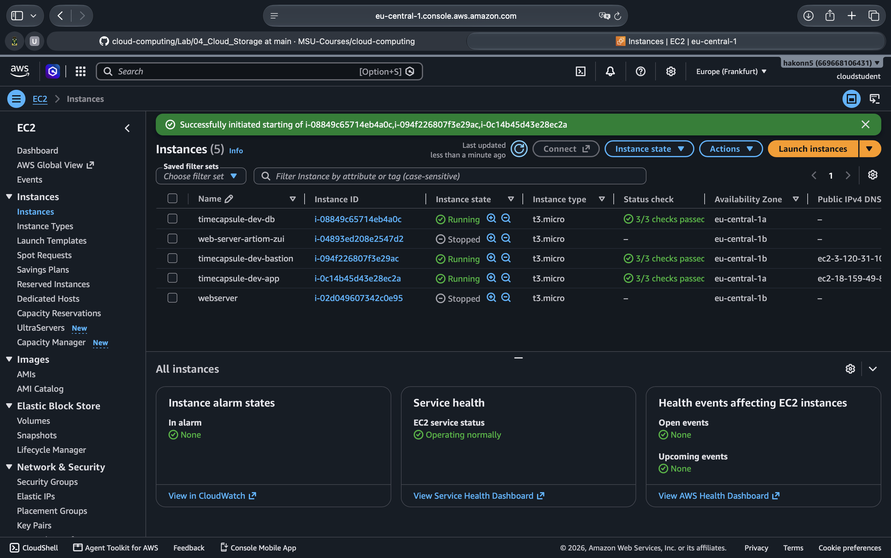

Bastion, app-server и db-server находятся в состоянии `Running`, у каждого пройдены `3/3` проверки. Два дополнительных экземпляра остаются остановленными.

[Сетевые параметры запущенных экземпляров](images/00g-instances-running-network.png): у db-server нет публичного IPv4; адрес приложения остаётся `18.159.49.8`. Публичный IP bastion на момент снимка — `3.120.31.106`; при следующем запуске он может измениться.

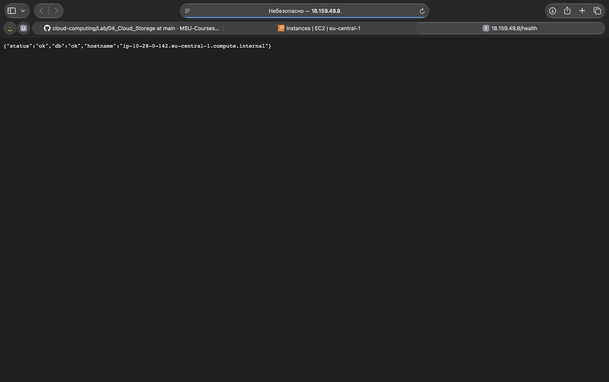

По адресу `http://18.159.49.8/health` получен JSON:

```json
{"status":"ok","db":"ok","hostname":"ip-10-28-0-142.eu-central-1.compute.internal"}
```

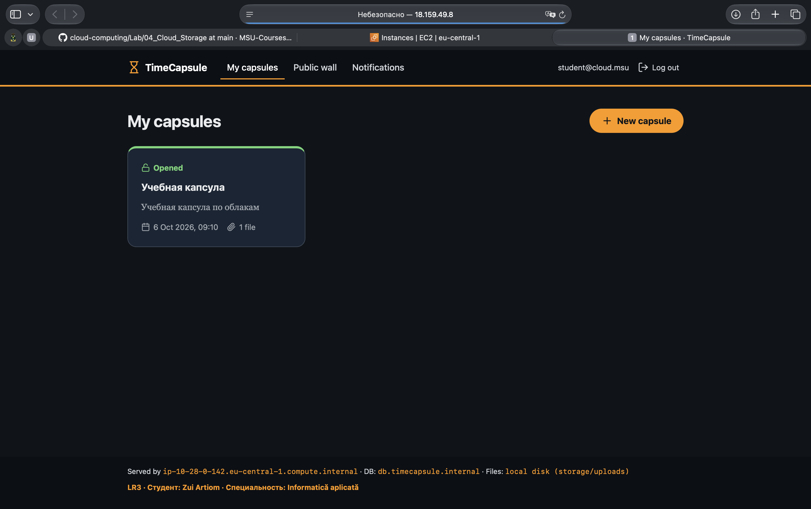

После входа видна «Учебная капсула» от 6 октября 2026 года с одним вложением. В подвале указаны `DB: db.timecapsule.internal`, `Files: local disk (storage/uploads)` и маркировка `LR3`.

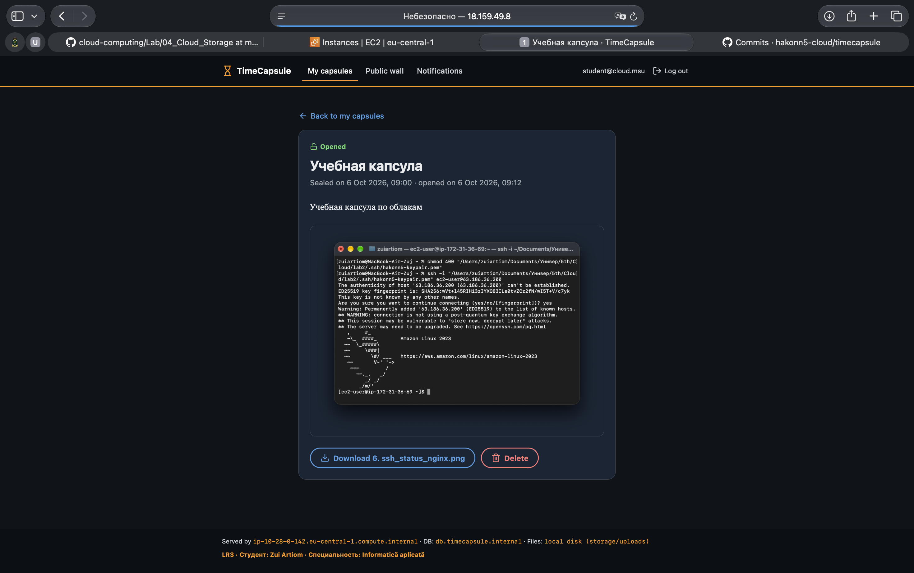

На странице «Учебная капсула» отображается старое вложение — изображение `6. ssh_status_nginx.png`, загруженное в ЛР2. Чтение файла из локального хранилища подтверждено; на странице также доступна кнопка скачивания.

## 1. Выполнение заданий ЛР4

### Задание 1. Бакет и объекты в консоли

Создан бакет `timecapsule-dev-uploads-hakonn5` в регионе `eu-central-1`. В префикс `uploads/` загружены два объекта класса `Standard`:

| Ключ | Размер в консоли |
| --- | --- |
| `uploads/Cloud_06_Cloud_Storage.pdf` | 2.2 MB |
| `uploads/maxresdefault.jpg` | 45.4 KB |

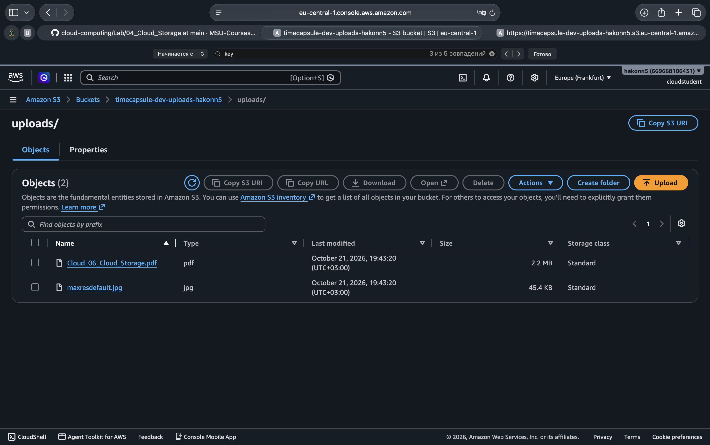

В свойствах картинки проверены ключ `uploads/maxresdefault.jpg`, регион, ETag, S3 URI, ARN и Object URL.

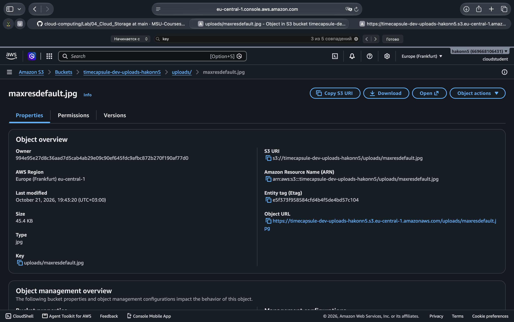

Прямой Object URL:

```text
https://timecapsule-dev-uploads-hakonn5.s3.eu-central-1.amazonaws.com/uploads/maxresdefault.jpg
```

При открытии прямой ссылки браузер получает XML-ответ с кодом `AccessDenied`.

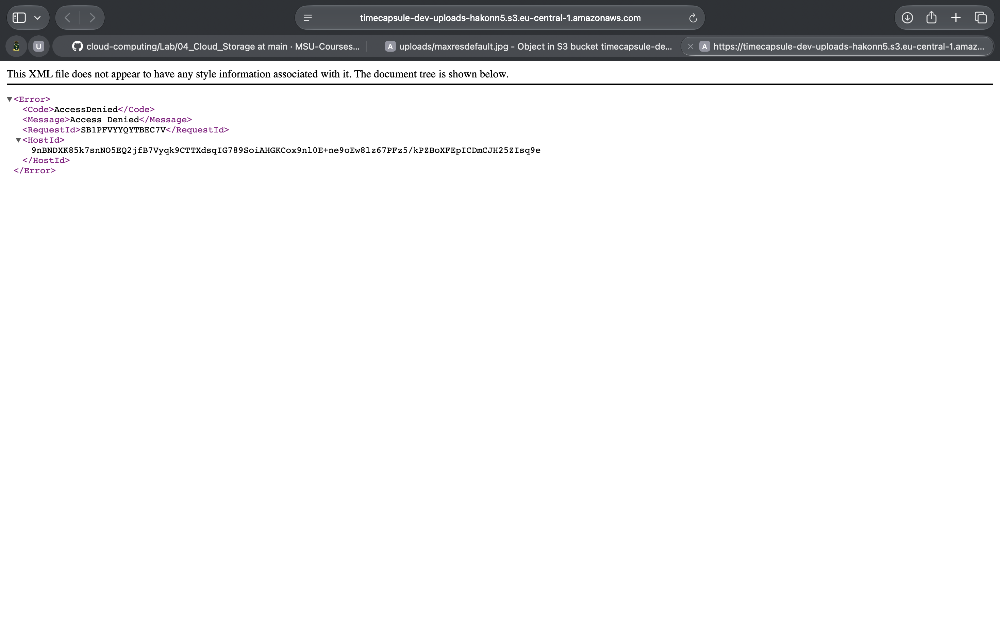

**Ответы на вопросы задания 1:**

- Ключ картинки — `uploads/maxresdefault.jpg`: префикс является частью ключа объекта.
- Вход в консоль AWS сам по себе не авторизует обычный браузерный запрос к Object URL. Для закрытого объекта нужен авторизованный запрос или подписанная ссылка.
- Кнопка `Create folder` создаёт нулевой объект с ключом, заканчивающимся на `/`. В списке консоли такой префикс представлен как папка.

В префикс `backups/` загружен текстовый Markdown-файл `0002-database-placement.md` размером 8.2 KB. Markdown является текстовым форматом и соответствует требованию загрузить любой текстовый файл.

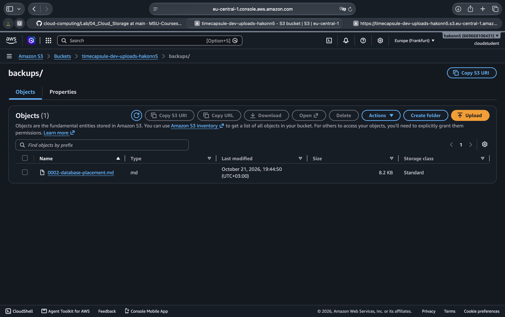

В системных метаданных картинки подтверждено `Content-Type: image/jpeg`.

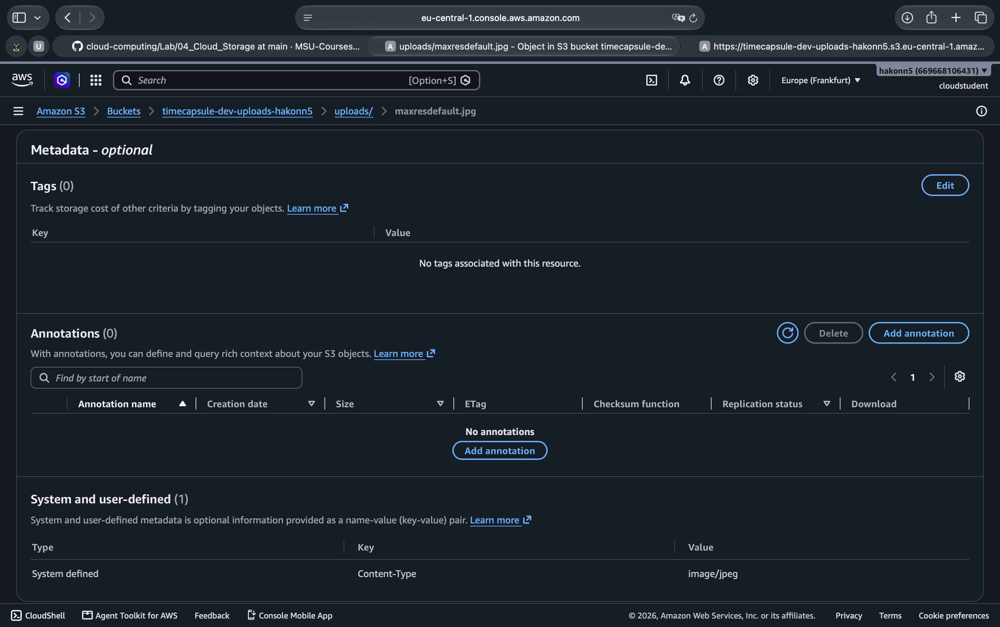

Обязательные теги по условию назначаются самому бакету; отдельные теги у картинки не заданы.

### Задание 2. Объекты из командной строки

Команды выполнены в AWS CloudShell в регионе `eu-central-1`. Созданы локальные файлы `photo.txt`, `2026/10/report.txt` и `2026/10/report-2.txt`. Файл `photo.txt` загружен через `aws s3 cp`, каталог `2026` — через `aws s3 sync` под префикс `uploads/2026`.

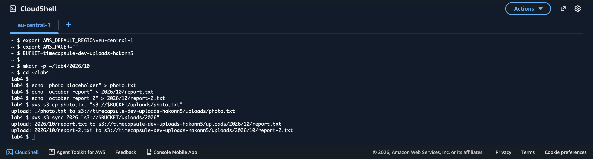

Содержимое бакета просмотрено тремя командами:

```bash
aws s3 ls "s3://$BUCKET"
aws s3 ls "s3://$BUCKET/uploads/"
aws s3 ls "s3://$BUCKET" --recursive
```

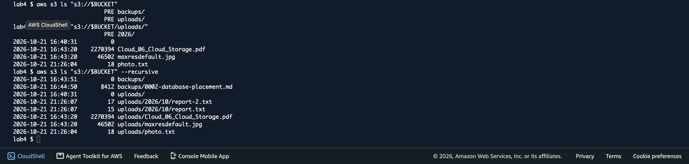

Первая команда вывела `PRE backups/` и `PRE uploads/`; вторая — непосредственные объекты `uploads/` и префикс `2026/`; рекурсивная команда показала полные ключи, включая текстовый файл из `backups/` и оба отчёта.

Метаданные картинки и текстового отчёта прочитаны через `aws s3api head-object` без скачивания содержимого:

| Ключ | ContentLength, байт | ContentType | ServerSideEncryption |
| --- | ---: | --- | --- |
| `uploads/maxresdefault.jpg` | 46502 | `image/jpeg` | `AES256` |
| `uploads/2026/10/report.txt` | 15 | `text/plain` | `AES256` |

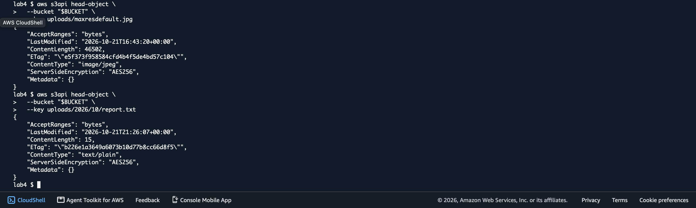

Объект `uploads/photo.txt` скачан в `downloaded.txt`. Команда `cat downloaded.txt` вывела `photo placeholder`. Объект `uploads/2026/10/report-2.txt` удалён; повторный список префикса `uploads/2026/10/` содержит только `report.txt`.

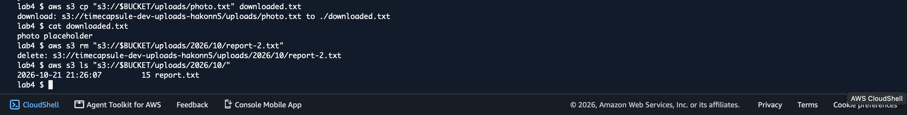

**Ответы на вопросы задания 2:**

- Без рекурсии CLI группирует ключи по разделителю `/` и показывает общие префиксы как `PRE`. С `--recursive` выводятся полные ключи объектов без такого группирования. S3 при этом хранит объекты с ключами, а не дерево каталогов файловой системы.
- `report.txt` получил `Content-Type: text/plain`. AWS CLI определил MIME-тип по расширению локального файла при загрузке; задавать его вручную для этого файла не понадобилось.

### Задание 3. Политика бакета: только HTTPS

В бакете сохранена политика [bucket-https-only.json](policies/bucket-https-only.json). Правило `DenyInsecureTransport` запрещает всем участникам (`Principal: "*"`) любые действия S3 с бакетом и его объектами, если `aws:SecureTransport` равно `false`. Указаны ARN бакета и объектов (`/*`). Block Public Access остаётся включённым.

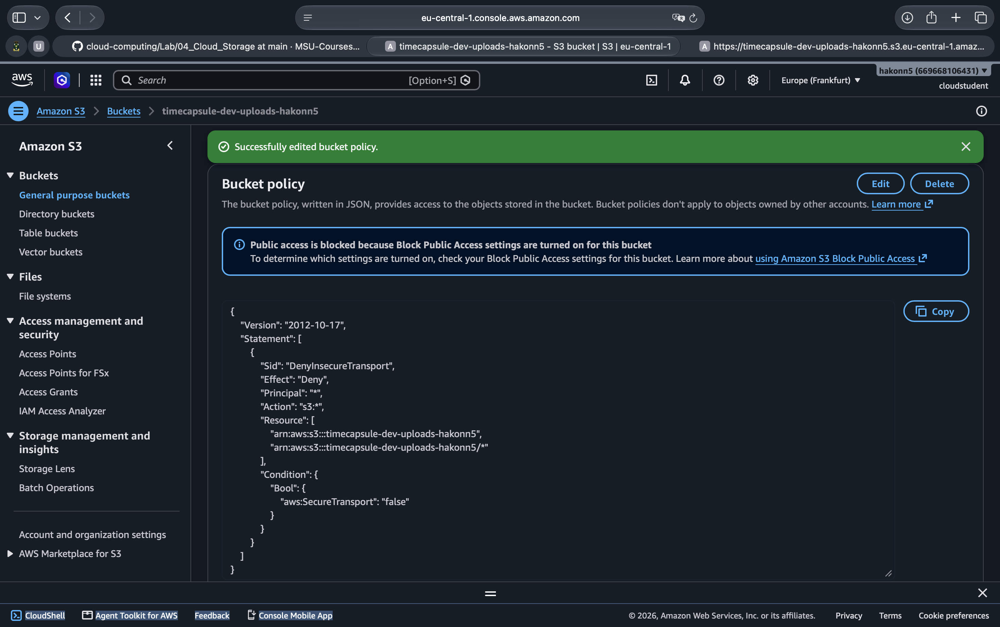

В CloudShell выполнены две проверки:

```bash
aws s3 ls "s3://$BUCKET/uploads/"
aws s3 ls "s3://$BUCKET/uploads/" --endpoint-url http://s3.eu-central-1.amazonaws.com
```

| Запрос | Результат |
| --- | --- |
| HTTPS, endpoint по умолчанию | Список объектов успешно получен |
| HTTP, endpoint указан явно | `AccessDenied` при `ListObjectsV2`, явный запрет в resource-based policy |

В сообщении отказа указан IAM-пользователь `cloudstudent`: запрос выполнен от его имени и отклонён политикой бакета.

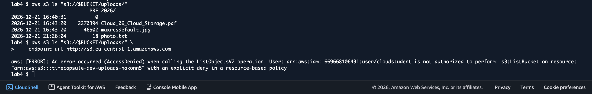

**Ответы на вопросы задания 3:**

- Явный запрет `Deny` имеет приоритет над разрешениями администратора. У HTTP-запроса условие `aws:SecureTransport=false` истинно, поэтому доступ отклоняется.
- Block Public Access не мешает сохранить это правило с `Principal: "*"`, поскольку правило только запрещает запросы и не предоставляет публичного доступа. Наличие `*` в поле Principal само по себе не означает публичное разрешение.

### Задание 4. Версионирование и защита от удаления

У объектов, загруженных до включения версионирования, отображается Version ID `null`.

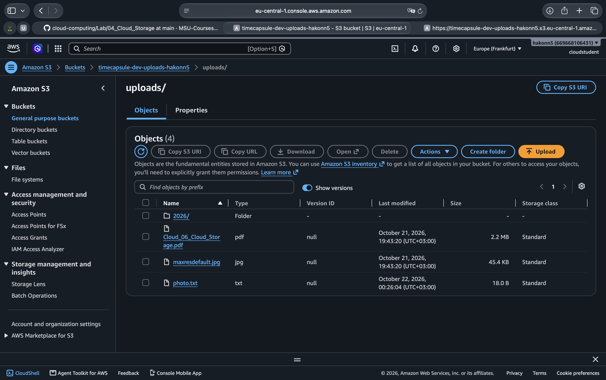

Под ключом `uploads/notes.txt` созданы две версии размером по 2 байта с разными Version ID. На снимке новая версия датирована 01:00:41, предыдущая — 01:00:00 (время консоли UTC+03:00).

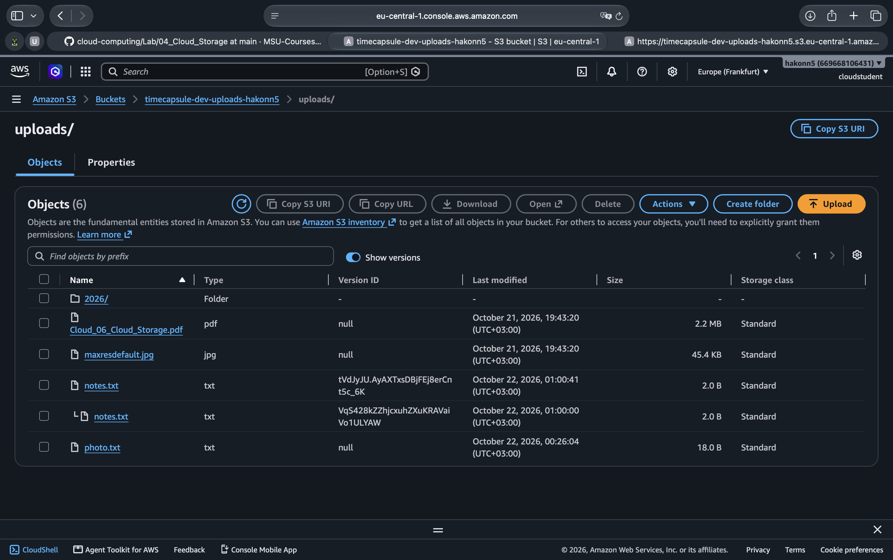

После обычного удаления объекта появилась третья строка с типом `Delete marker`, при этом обе версии данных сохранились.

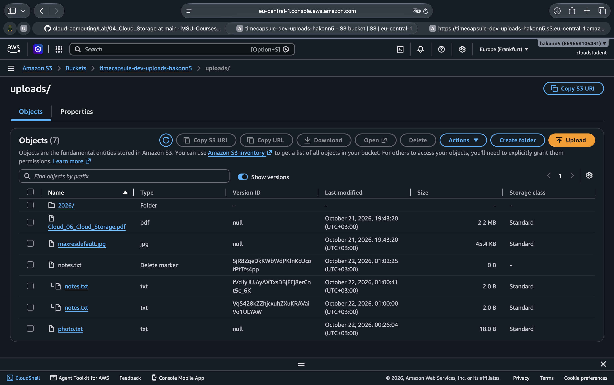

Представлен результат открытия объекта с содержимым `v2` после восстановления.

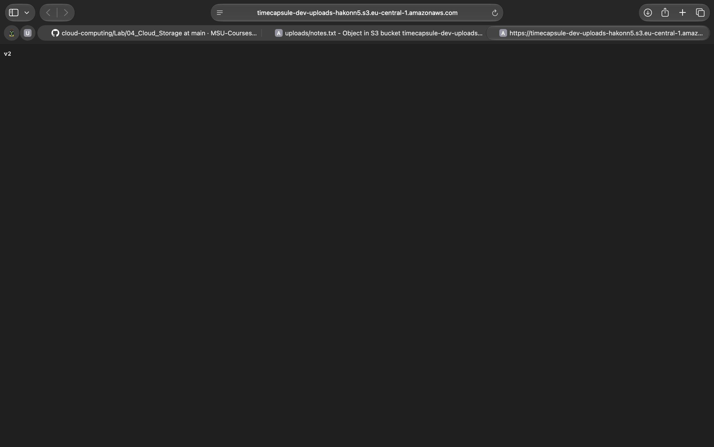

После отката представлен результат открытия объекта с содержимым `v1`.

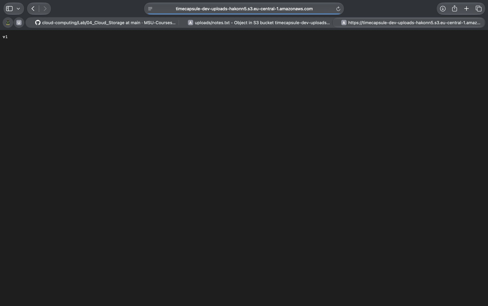

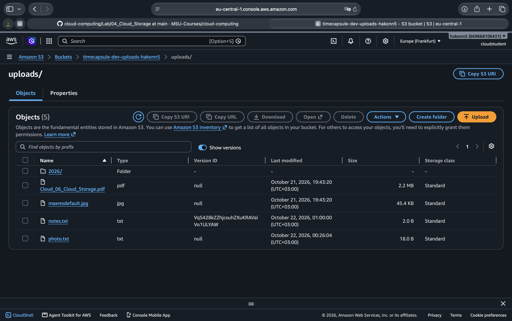

Финальный список при включённом `Show versions` подтверждает, что у `uploads/notes.txt` осталась только первая версия данных от 01:00:00 (UTC+03:00). Вторая версия и маркер удаления отсутствуют. Вместе со снимком содержимого `v1` это подтверждает завершение отката.

**Ответы на вопросы задания 4:**

- Обычное удаление без Version ID создаёт маркер удаления, скрывающий объект. Данные предыдущих версий остаются, а удаление маркера возвращает последнюю версию в обычный список.
- Удаление конкретной версии по её Version ID окончательно уничтожает эту версию. В отличие от удаления через маркер, эта операция не отменяется средствами истории того же объекта. Поэтому приложению следует разрешить обычное удаление и не предоставлять `s3:DeleteObjectVersion`.

### Задание 5. Правило жизненного цикла

Создано правило `timecapsule-dev-noncurrent`, статус `Enabled`, область действия — префикс `uploads/`. На снимке конфигурации подтверждены следующие настройки:

| Настройка | Значение |
| --- | --- |
| Действия над текущими версиями | Не заданы |
| Переход неактуальных версий | Standard-IA через 30 дней |
| Количество версий, исключаемых из перехода | 0 |
| Окончательное удаление неактуальных версий | Через 90 дней |
| Сохраняемые новейшие неактуальные версии при удалении | 2 |
| Дополнительные фильтры по тегам и размеру | Не заданы |

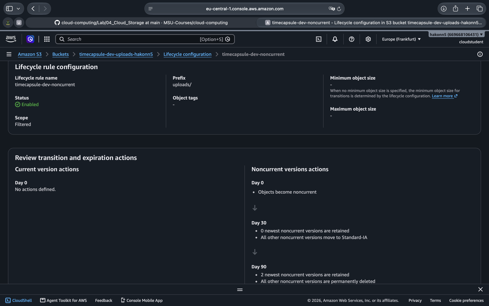

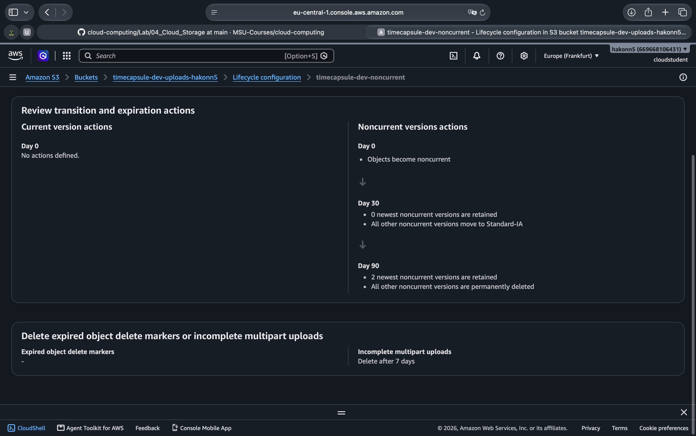

В сохранённой конфигурации подтверждено `Incomplete multipart uploads: Delete after 7 days`. Автоматическое удаление expired object delete markers не задано. Проверка задания выполнена по конфигурации; фактического наступления сроков 7, 30 и 90 дней не ожидали.

**Ответы на вопросы задания 5:**

- После первой загрузки и десяти перезаписей у объекта будет одна текущая и десять неактуальных версий. Каждая подходящая по размеру неактуальная версия становится доступна для перехода в Standard-IA через 30 дней после потери актуальности. Удаление применяется после 90 дней только к версиям за пределами двух новейших неактуальных; обе проверки должны выполняться одновременно.
- По умолчанию объекты меньше 128 КБ не переходят в другие классы хранения через Lifecycle. Поэтому маленькие `notes.txt`, `photo.txt` и JPG размером 45.4 KB не перейдут в Standard-IA; правило удаления неактуальных версий при этом продолжает действовать. PDF размером 2.2 MB под это ограничение по размеру не попадает.
- При незавершённой multipart-загрузке уже загруженные части занимают оплачиваемое место, хотя готового объекта ещё нет. Правило прерывает такие загрузки и удаляет части через 7 дней после начала.
- Префикс `backups/` находится за пределами фильтра `uploads/` и этим правилом не затрагивается. Текущие версии объектов правило не перемещает и не удаляет.

### Задание 6. Подписанные URL

Картинка `uploads/maxresdefault.jpg` открыта по подписанной ссылке в приватном окне браузера. При этом обычный Object URL ранее возвращал `AccessDenied`, то есть временная ссылка предоставляет доступ к закрытому объекту без открытия бакета для всех.

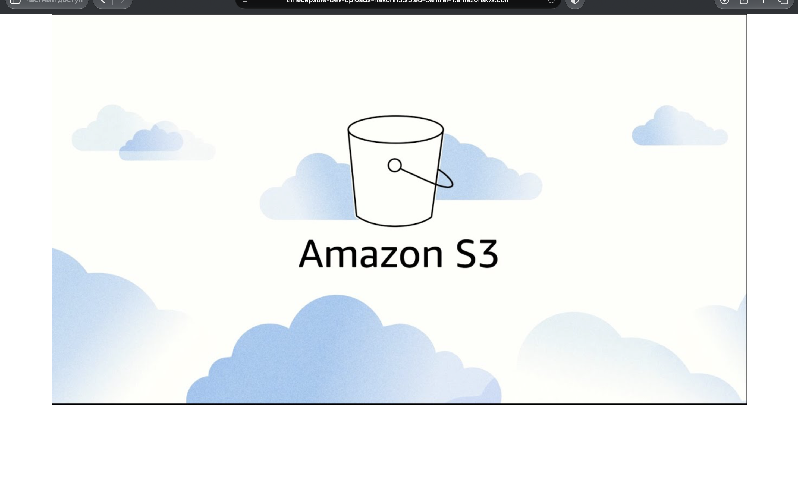

Для текстового объекта использована команда:

```bash
aws s3 presign "s3://$BUCKET/uploads/photo.txt" --expires-in 120
```

По полученной ссылке в приватном окне браузера отображается текст `photo placeholder`.

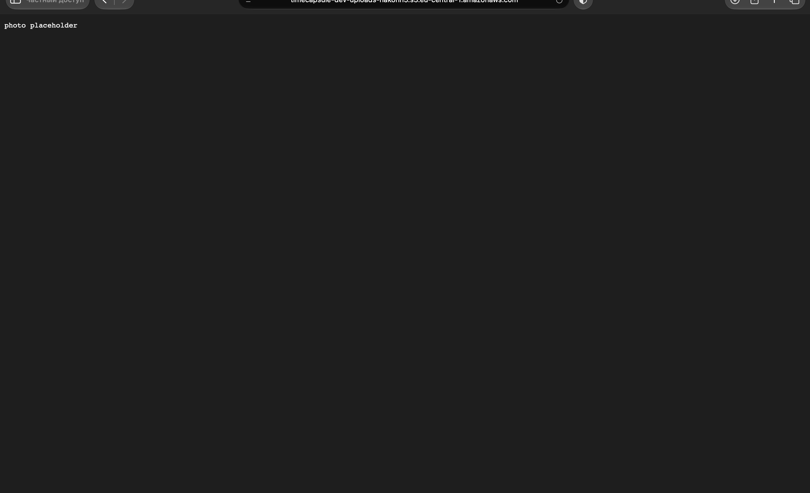

После истечения срока S3 вернул XML-ответ:

```text
Code: AccessDenied
Message: Request has expired
X-Amz-Expires: 120
```

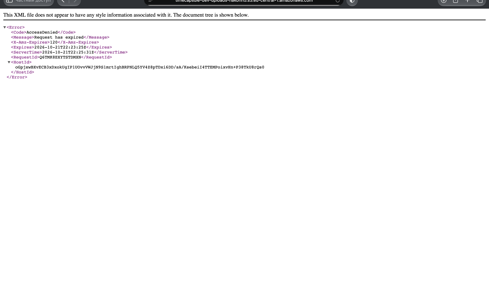

Повторный запрос также получил `AccessDenied` с сообщением `Request has expired`.

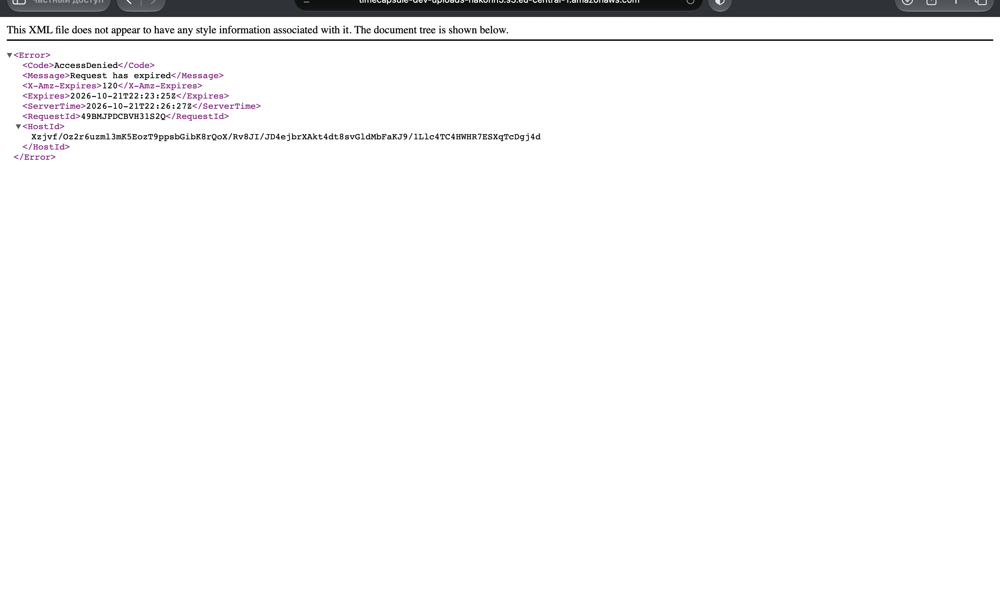

**Ответы на вопросы задания 6:**

- У представленных отказов причина — истечение срока действия: это прямо указано в `Message`. Эти ответы не демонстрируют ошибку проверки подписи.
- Ключ объекта участвует в вычислении подписи запроса. Изменение `photo.txt` на `notes.txt` без пересоздания подписи должно нарушить её соответствие запросу; отдельно проверить это можно до истечения срока ссылки.
- Команда `aws s3 presign` вычисляет подпись локально и не проверяет наличие объекта запросом в S3. Получение или обновление используемых учётных данных может требовать отдельного обращения к их источнику.
- Срок ссылки ограничен указанным временем и сроком действия учётных данных подписавшего её пользователя или роли. Для доступа по ссылке не требуется публичное разрешение на чтение бакета.
