# Лабораторная работа №5. Облачные базы данных. Amazon RDS

- **ФИО:** Zui Artiom
- **Группа:** IA2403
- **Специальность:** Informatică aplicată
- **Целевой уровень:** продвинутый
- **Приложение:** TimeCapsule, процедурный PHP
- **Репозиторий:** [hakonn5-cloud/timecapsule](https://github.com/hakonn5-cloud/timecapsule)
- **Регион:** eu-central-1 (Frankfurt)
- **Условие:** [ЛР5 — Amazon RDS](https://github.com/MSU-Courses/cloud-computing/blob/main/Lab/05_Cloud_Database/readme.md)
- **Статус:** задания 1–12 выполнены; учебные ресурсы Части 1 удалены. PostgreSQL перенесён с EC2 в RDS, старый db-server удалён. Остановка постоянных ресурсов по завершении и отдельная финансовая очистка этим отчётом не подтверждаются.

## 0. Исходный стенд

По отчётам ЛР3–ЛР4 приложение использует VPC `timecapsule-dev-vpc` (`10.28.0.0/16`), приватные подсети `timecapsule-dev-private-a` (`10.28.10.0/24`, `eu-central-1a`) и `timecapsule-dev-private-b` (`10.28.11.0/24`, `eu-central-1b`). PostgreSQL 16 размещён на EC2 `timecapsule-dev-db`, приложение обращается к нему по имени `db.timecapsule.internal`. Вложения перенесены в S3. Это исходные сведения из предыдущих работ; текущее состояние ресурсов ещё предстоит проверить.

Для подключений к учебной базе выбран существующий `timecapsule-dev-app` в той же VPC. Условие допускает использование `app-server`. Запросы к БД выполняются с EC2; CloudShell для подключений к PostgreSQL не используется.

## 1. Учебная база

### Задание 1. Размещение и доступ к базе

Создана группа подсетей `lab5-db-subnets` в VPC `timecapsule-dev-vpc` (`vpc-083255eb804055334`), регион `eu-central-1`, тип сети IPv4.

| Подсеть | Subnet ID | CIDR | Зона доступности |
| --- | --- | --- | --- |
| `timecapsule-dev-private-a` | `subnet-012a7069d039bc215` | `10.28.10.0/24` | `eu-central-1a` |
| `timecapsule-dev-private-b` | `subnet-0b785ac2fed51f888` | `10.28.11.0/24` | `eu-central-1b` |

У группы подсетей заданы теги `Name=lab5-db-subnets`, `Project=timecapsule`, `Environment=dev`, `Owner=hakonn5`, `Lab=lab5`.

В той же VPC созданы две Security Group:

| Группа | Security Group ID | Входящие правила |
| --- | --- | --- |
| `lab5-web-sg` | `sg-080b70e7f80cdf7ed` | Нет |
| `lab5-rds-sg` | `sg-0358abea00daf7082` | PostgreSQL, TCP 5432, источник `sg-080b70e7f80cdf7ed` (`lab5-web-sg`) |

Группа `lab5-web-sg` назначена экземпляру `timecapsule-dev-app` (`i-0c14b45d43e28ec2a`) дополнительно к существующей `timecapsule-dev-web-sg` (`sg-0d642a1ece33b712d`). Постоянные правила HTTP, SSH и доступа к прежней БД сохранены. Изменение выполнено при остановленном экземпляре.

На момент проверки все пять отображаемых экземпляров EC2 находились в состоянии `Stopped`, включая bastion, app-server и db-server. Учебная RDS на этом этапе ещё не создана; проверка фактического подключения относится к заданию 3.

**Почему источник — Security Group, а не IP?** Правило связывает доступ с сетевыми интерфейсами, которым назначена группа, и не требует изменений при смене IP сервера. Доступ получит любой подходящий клиент с этой группой, поэтому её привязку тоже нужно контролировать.

**Зачем две подсети при Single-AZ?** RDS требует, чтобы обычная группа подсетей охватывала как минимум две зоны доступности. Это позволяет выбирать размещение и использовать другую зону, в том числе для реплики; само наличие двух подсетей не создаёт резервный экземпляр и не включает Multi-AZ.

Основание: [сценарий EC2 и RDS в одной VPC](https://docs.aws.amazon.com/AmazonRDS/latest/UserGuide/USER_VPC.Scenarios.html), [требования CreateDBSubnetGroup](https://docs.aws.amazon.com/AmazonRDS/latest/APIReference/API_CreateDBSubnetGroup.html).

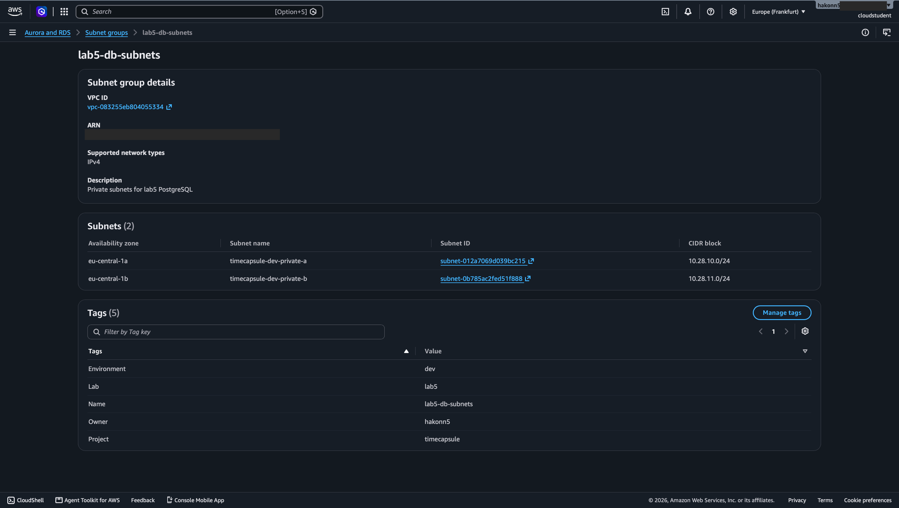

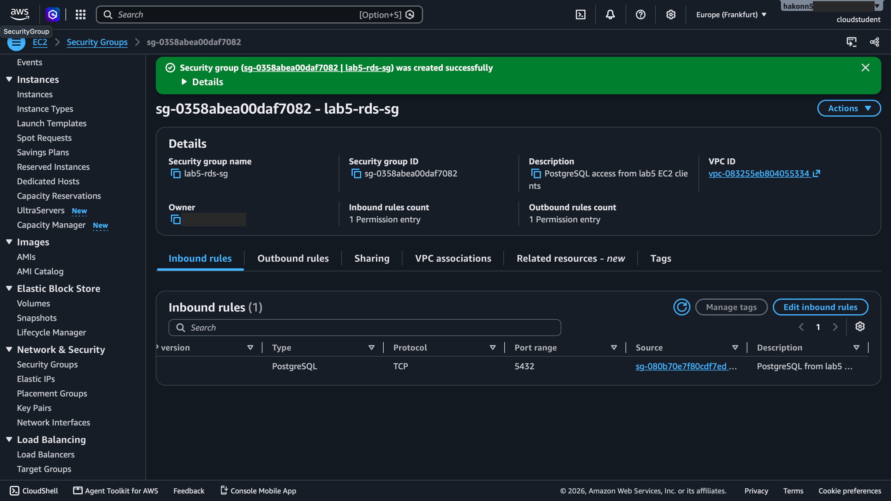

### Задание 2. База RDS

Создан экземпляр `lab5-db`, состояние `Available`. Параметры проверены на вкладках Connectivity & security, Configuration, Maintenance & backups и Tags.

| Параметр | Значение |
| --- | --- |
| Движок | PostgreSQL 18.6 |
| Класс | `db.t4g.micro`, 2 vCPU, 1 GiB RAM |
| Размещение | Single-AZ, `eu-central-1a`, Multi-AZ: No |
| Внутренняя база | `lab5` |
| Администратор | `dbadmin` |
| Endpoint | `lab5-db.cr4myc6kwzsa.eu-central-1.rds.amazonaws.com` |
| Порт | TCP 5432 |
| VPC | `timecapsule-dev-vpc` (`vpc-083255eb804055334`) |
| Группа подсетей | `lab5-db-subnets`, две приватные подсети из задания 1 |
| Security Group | `lab5-rds-sg` (`sg-0358abea00daf7082`), Active |
| Publicly accessible | No |
| Тип сети | IPv4 |
| Хранилище | gp3, 20 GiB; 3000 IOPS, 125 MiB/s |
| Storage autoscaling | Disabled |
| Шифрование хранилища | Enabled, ключ `aws/rds` |
| Deletion protection | Enabled |
| Автоматические резервные копии | Enabled, хранение 7 дней |
| Окно резервного копирования | 01:48–02:18 UTC |
| Автоматические минорные обновления | Enabled |
| Мониторинг | Database Insights — Standard; Enhanced Monitoring — Disabled |
| IAM DB authentication | Not enabled |
| RDS Extended Support | Disabled |

На момент проверки имеется автоматический снимок в состоянии `Available`, а поле Latest restore time уже заполнено. Автоматические резервные копии хранятся семь дней; копирование тегов в снимки включено.

У экземпляра заданы пять тегов: `Name=lab5-db`, `Project=timecapsule`, `Environment=dev`, `Owner=hakonn5`, `Lab=lab5`.

**Как проверить ограничение доступа?** В конфигурации отключён публичный доступ и назначена группа с входящим TCP 5432 только от клиентской Security Group. В задании 3 подтверждены успешное подключение с разрешённого app-server и тайм-аут прямого подключения с локального компьютера.

**Почему выбрана `eu-central-1a`?** App-server находится в этой же зоне, поэтому основное подключение не пересекает границу зон. Вторая приватная подсеть в `eu-central-1b` потребуется для учебной реплики.

**От чего защищает deletion protection?** Она запрещает удалить экземпляр RDS, пока защиту не отключат. Она не предотвращает удаление строк или таблиц SQL-командами и не заменяет резервное копирование.

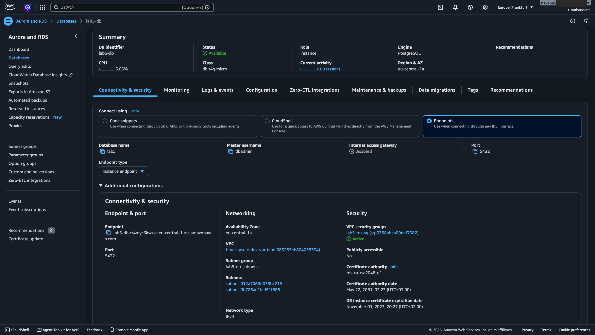

### Задание 3. Подключение к базе

Установлено SSH-соединение с Mac через bastion к app-server. В терминале подтверждён пользователь `ec2-user` на узле `ip-10-28-0-142`. Bastion доступен по публичному IPv4 `63.178.192.108`; его приватный адрес — `10.28.1.66`.

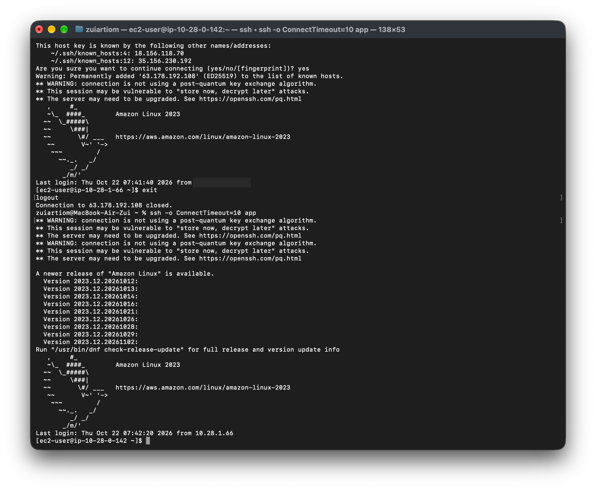

На app-server проверены `hostname`, `whoami` и `psql --version`: узел `ip-10-28-0-142.eu-central-1.compute.internal`, пользователь `ec2-user`, клиент PostgreSQL 16.15. Команда `getent ahostsv4` разрешила endpoint учебной RDS в приватный адрес `10.28.10.10`.

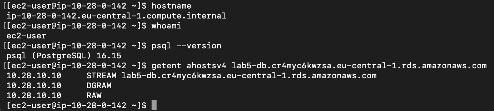

Подключение к `lab5` под `dbadmin` успешно выполнено с app-server с параметрами `sslmode=require` и `connect_timeout=10`. Сервер — PostgreSQL 18.6, адрес `10.28.10.10`, порт 5432. По `\conninfo` подтверждено TLS 1.3, шифр `TLS_AES_256_GCM_SHA384`, сжатие выключено. Клиент сообщил предупреждение о разных основных версиях 16 и 18; показанные SQL-запросы и `\conninfo` выполнены успешно.

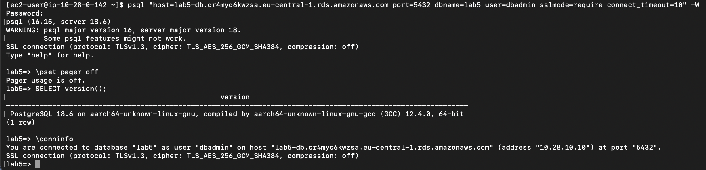

Создана таблица `notes` с колонками `id SERIAL PRIMARY KEY`, `body VARCHAR(100) NOT NULL`, `created_at TIMESTAMPTZ NOT NULL DEFAULT now()`. Вставлены строки `first`, `second`, `third`; результат `INSERT 0 3` и выборка подтвердили три записи с ID 1–3.

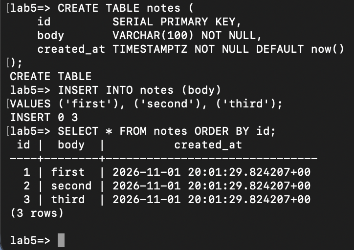

С локального Mac выполнены две первоначальные проверки. `dig +short` не вывел записей; для выяснения результата затем получены полные ответы DNS, приведённые ниже. Проверка `nc -vz -G 5` к endpoint по порту 5432 завершилась `Operation timed out`: прямое TCP-подключение с Mac не установлено.

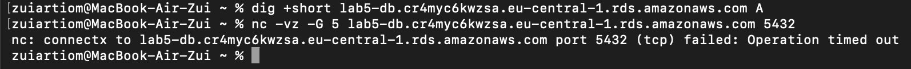

Полный DNS-запрос с Mac через настроенный сервер `192.168.100.1` вернул `SERVFAIL`, `ANSWER: 0`. Поэтому краткий режим `dig +short` не показывал IP. Причина ошибки внутри этого DNS-сервера отдельно не установлена.

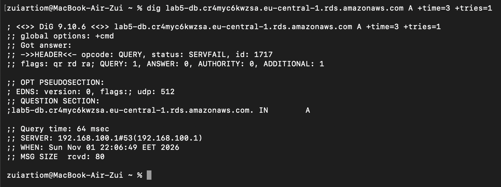

Тот же запрос с Mac напрямую к DNS `1.1.1.1` завершился `NOERROR`, `ANSWER: 1`: A-запись endpoint содержит `10.28.10.10`, TTL на момент ответа — 5 секунд. Адрес совпадает с полученным на app-server и показанным в `\conninfo`.

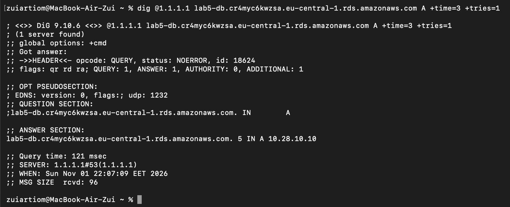

Разрешение имени в приватный IP не создаёт маршрут из домашней сети к RDS. Подтверждены успешное SQL-подключение с app-server, TLS, три строки в `notes`, DNS-проверки с EC2 и Mac и тайм-аут прямого TCP-подключения с Mac. Задание 3 выполнено.

### Задание 4. Реплика для чтения

Создана реплика для чтения `lab5-db-replica` от основной базы `lab5-db`, состояние `Available`, роль `Replica`.

| Параметр | Значение |
| --- | --- |
| Движок | PostgreSQL 18.6 |
| Класс | `db.t4g.micro`, 2 vCPU, 1 GiB RAM |
| Размещение | `eu-central-1b`, Multi-AZ: No |
| Endpoint | `lab5-db-replica.cr4myc6kwzsa.eu-central-1.rds.amazonaws.com` |
| Приватный IPv4 при подключении | `10.28.11.106` |
| База, пользователь, порт | `lab5`, `dbadmin`, TCP 5432 |
| VPC и группа подсетей | `timecapsule-dev-vpc`, `lab5-db-subnets` |
| Security Group | `lab5-rds-sg` (`sg-0358abea00daf7082`) |
| Publicly accessible | No |
| Хранилище | gp3, 20 GiB, 3000 IOPS, 125 MiB/s |
| Шифрование | Enabled, `aws/rds` |
| Storage autoscaling | Disabled |
| Deletion protection | Disabled |
| Мониторинг | Database Insights — Standard; Enhanced Monitoring — Disabled |

На момент снимков консоль показывала фоновую инициализацию хранилища и одновременно состояние `Available`. Подключение и SQL-проверки ниже выполнены успешно.

На реплике `\conninfo` подтвердил endpoint реплики и TLS 1.3. Запрос `SELECT pg_is_in_recovery();` вернул `t`. В таблице находились три исходные строки, а попытка `INSERT INTO notes (body) VALUES ('from replica');` завершилась ожидаемой ошибкой `cannot execute INSERT in a read-only transaction`.

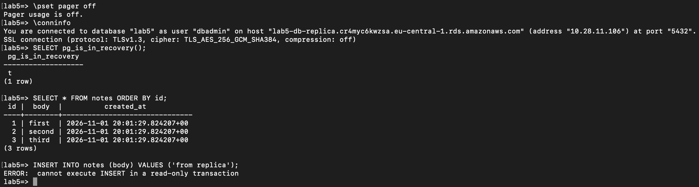

На основной базе тот же запрос `pg_is_in_recovery()` вернул `f`. Вставка строки `fourth` завершилась `INSERT 0 1`, после чего выборка показала четыре строки с ID 1–4.

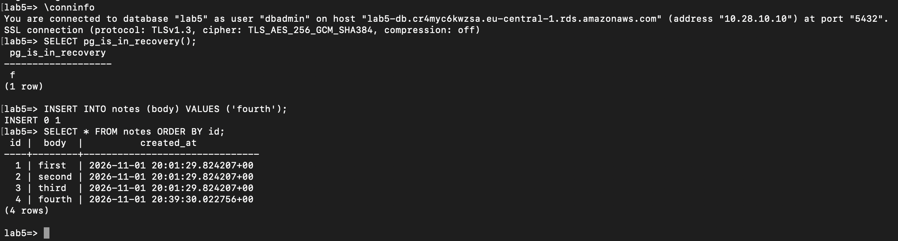

Повторная выборка с endpoint реплики показала все четыре строки, включая `fourth` с тем же временем создания, что на основной базе. Тем самым поступление изменений с основной базы на реплику подтверждено.

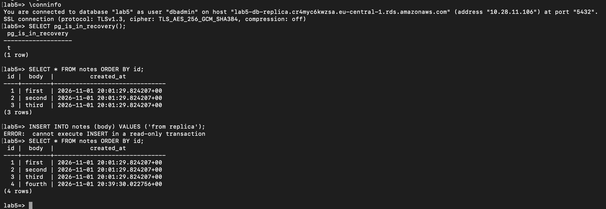

На графике CloudWatch `ReplicaLag` для `lab5-db-replica` выбраны статистика `Average`, период агрегации 5 минут и диапазон 1 час. В точке `2026-11-01 20:30:00 UTC` показано 41 секунду. Это значение метрики за выбранный интервал; по нему не определяется точная задержка поступления конкретной строки `fourth`.

**Почему INSERT на реплике не выполнился?** Реплика PostgreSQL применяет изменения основной базы и предоставляет соединения для чтения. Изменения данных выполняются на основной базе, после чего асинхронно передаются реплике.

**Чем реплика отличается от резервного экземпляра Multi-AZ?** Реплика для чтения имеет собственный endpoint и обслуживает запросы чтения; её репликация асинхронная. В классическом развёртывании RDS Multi-AZ с основным и резервным экземплярами standby синхронно поддерживает копию для автоматического переключения при отказе и не обслуживает отдельные запросы чтения.

Задание 4 выполнено. Затем реплика использована для проверки распространения удаления в задании 5.

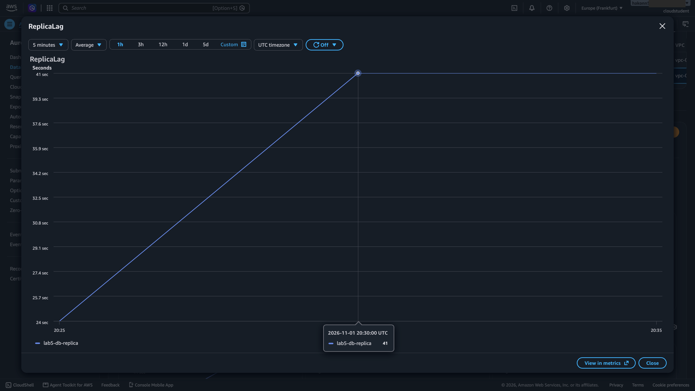

### Задание 5. Восстановление после ошибки

Перед удалением на основной базе `lab5-db` проверены четыре строки в `notes` и сохранён момент восстановления:

| Часовой пояс | Дата и время |
| --- | --- |
| UTC | `2026-11-01 20:48:07.156289` |
| Europe/Chisinau, UTC+02:00 | `2026-11-01 22:48:07.156289` |

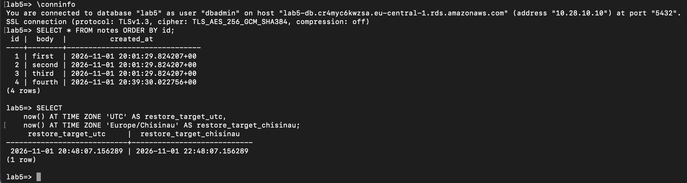

На основной базе выполнен `DELETE FROM notes;`, получен ответ `DELETE 4`. Последующая выборка показала `0 rows`.

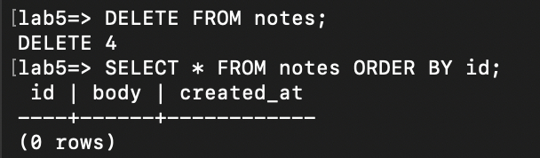

Выборка с endpoint `lab5-db-replica` (`10.28.11.106`) также показала `0 rows`: удаление распространилось на реплику.

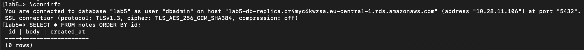

После этого реплика удалена. В списке RDS без поискового фильтра отображается один экземпляр — `lab5-db`, состояние `Available`.

На вкладке Maintenance & backups показаны автоматические резервные копии за семь дней и Latest restore time `2026-11-01 22:51 UTC+02:00`, то есть позже выбранного момента. В форме PITR доступная граница дополнительно уточнена до `22:51:40 UTC+02:00`.

В окончательной форме выставлено время `2026-11-01 22:48:07 UTC+02:00` (`20:48:07 UTC`), источник `lab5-db`, целевой экземпляр `lab5-db-restore`.

Параметры формы проверены перед запуском:

| Параметр | Значение |
| --- | --- |
| Класс и размещение | `db.t4g.micro`, Single-AZ |
| Хранилище | gp3, 20 GiB, autoscaling выключено |
| VPC | `timecapsule-dev-vpc` |
| Группа подсетей | `lab5-db-subnets` |
| Зона | `eu-central-1a` |
| Public access | No |
| Security Group | Только `lab5-rds-sg` |
| Порт | 5432 |
| Аутентификация | Password authentication |
| Deletion protection | Выключено |
| Автоматические резервные копии | 7 дней, окно 01:48 UTC, длительность 0,5 часа |
| Теги | `Name=lab5-db-restore`, `Project=timecapsule`, `Environment=dev`, `Owner=hakonn5`, `Lab=lab5` |

Восстановление выполнено: экземпляр `lab5-db-restore` перешёл в состояние `Available`. На вкладке Connectivity & security подтверждены класс `db.t4g.micro`, зона `eu-central-1a`, VPC `timecapsule-dev-vpc`, группа подсетей `lab5-db-subnets`, единственная Security Group `lab5-rds-sg` и `Publicly accessible: No`.

С app-server установлено соединение с `lab5-db-restore.cr4myc6kwzsa.eu-central-1.rds.amazonaws.com`, приватный IPv4 `10.28.10.149`, база `lab5`, пользователь `dbadmin`, порт 5432. По `\conninfo` подтверждено TLS 1.3, шифр `TLS_AES_256_GCM_SHA384`.

Запрос `SELECT * FROM notes ORDER BY id;` вернул все четыре строки: `first`, `second`, `third`, `fourth`, с исходными ID и временем создания. Следовательно, состояние до ошибочного удаления восстановлено в отдельном экземпляре.

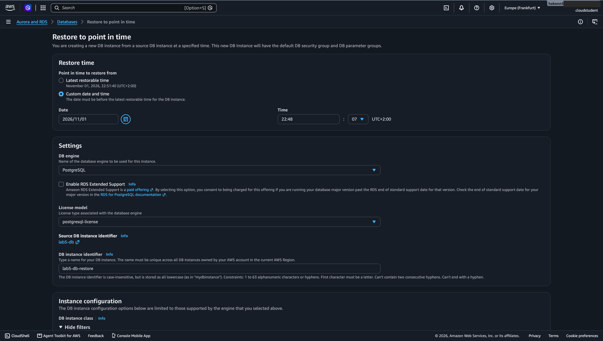

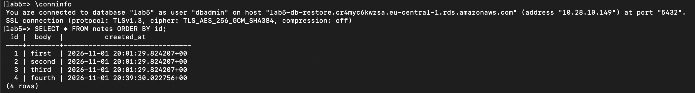

После проверки восстановленная копия удалена: консоль показала `Successfully deleted DB instance lab5-db-restore`. В списке без поискового фильтра осталась одна база — `lab5-db`, состояние `Available`. Реплика и восстановленная копия отсутствуют.

**Почему реплика не спасла данные?** Она применяет изменения основной базы, включая ошибочную команду DELETE. Поэтому удалённые строки исчезли и на реплике; для возврата прежнего состояния понадобилось восстановление из резервных копий и журналов.

**Почему PITR создаёт новый экземпляр?** Восстановление сохраняет текущую исходную базу и позволяет отдельно проверить данные на выбранный момент. После проверки можно переносить нужные данные или переключать приложение, не выполняя немедленный откат исходного экземпляра.

Задание 5 выполнено: возврат данных после удаления подтверждён, временные реплика и восстановленный экземпляр удалены.

### Завершение Части 1

После проверки PITR выполнена очистка временной инфраструктуры. На заключительных снимках подтверждены следующие результаты:

| Проверка | Результат |
| --- | --- |
| Automated backups → Retained | 0 сохранённых копий |
| Snapshots → Manual | 0 ручных снимков |
| DB subnet groups | `lab5-db-subnets` удалена, список пуст |
| Группы app-server | Осталась `timecapsule-dev-web-sg` (`sg-0d642a1ece33b712d`), временная клиентская группа отвязана |
| Security Groups, поиск `lab5` | Совпадений нет |

Bastion и app-server работают, у обоих пройдены проверки `3/3`. Исходный EC2 `timecapsule-dev-db` остаётся остановленным и сохранён для переноса данных в Части 2. Роль приложения `timecapsule-dev-app-role` сохранена.

Заключительный список RDS без поискового фильтра показывает `Databases (0)` и `No resources`: основная учебная база `lab5-db`, реплика и восстановленная копия удалены.

Базовая часть завершена: выполнены задания 1–5 и подтверждена очистка созданных учебных ресурсов.

## 2. База приложения

### Задание 6. База приложения

Созданы постоянные ресурсы для переноса приложения в Amazon RDS. На app-server проверена утилита `pg_dump`: версия 16.15. Версия новой RDS — PostgreSQL 16.15.

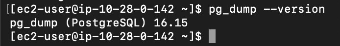

| Параметр | Фактическое значение |
| --- | --- |
| DB instance identifier | `timecapsule-dev-rds`, состояние `Available` |
| Engine / class | PostgreSQL 16.15 / `db.t4g.micro`, 2 vCPU, 1 GiB RAM |
| Размещение | Single-AZ, `eu-central-1a`, VPC `timecapsule-dev-vpc` |
| DB subnet group | `timecapsule-dev-db-subnets`: приватные подсети `10.28.10.0/24` и `10.28.11.0/24` в двух зонах |
| Security Group | `timecapsule-dev-rds-sg` (`sg-0d30a50253a41bf75`) |
| Входящее правило | TCP 5432 от `timecapsule-dev-web-sg` (`sg-0d642a1ece33b712d`) |
| Publicly accessible | `No` |
| Endpoint | `timecapsule-dev-rds.cr4myc6kwzsa.eu-central-1.rds.amazonaws.com` |
| Master username / port | `dbadmin` / 5432 |
| Storage | gp3, 20 GiB, 3000 IOPS, 125 MiB/s; autoscaling отключён |
| Encryption | Включено, ключ `aws/rds` |
| Automated backups | Включены, хранение 7 дней, окно 00:56–01:26 UTC |
| Copy tags to snapshots | Включено |
| Deletion protection | Включена |
| Enhanced Monitoring / Extended Support | Отключены |

У RDS и группы подсетей подтверждены теги `Name` с именем соответствующего ресурса, `Project=timecapsule`, `Environment=dev`, `Owner=hakonn5`, `Lab=lab5`.

Initial database name оставлено пустым: база приложения `timecapsule` на этом этапе не создана. В интерфейсе подключения предлагается служебная база `postgres`; в Configuration поле DB name — `-`. Подключение приложения и перенос данных ещё не выполнялись.

**Что изменить для production?** Размещение Multi-AZ выбирается с учётом требований к доступности и отказу зоны. Размер экземпляра и хранилища определяется измеренной нагрузкой; срок хранения и проверки восстановления — требованиями RPO/RTO. Для подключения нужно настроить проверку сертификата и имени сервера. Приватное размещение, ограничение доступа от группы приложения, шифрование и защита от удаления сохраняются.

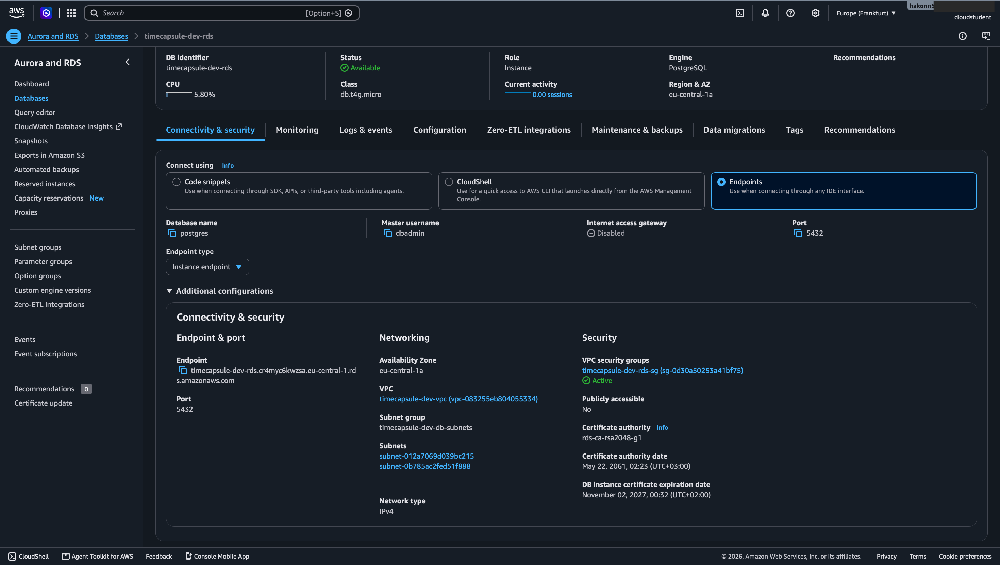

### Задание 7. Ночная остановка базы

Создана политика `timecapsule-dev-rds-stop`: единственное разрешённое действие `rds:StopDBInstance`, ресурс ограничен ARN экземпляра `timecapsule-dev-rds` в `eu-central-1`. Политика прикреплена к роли `timecapsule-dev-scheduler-role`. Доверительная политика разрешает `sts:AssumeRole` сервису `scheduler.amazonaws.com`.

Создано расписание EventBridge Scheduler `timecapsule-dev-rds-nightly-stop` в группе `default`, регион `eu-central-1`. Цель — универсальный вызов Amazon RDS `StopDBInstance` от имени `timecapsule-dev-scheduler-role` с входными данными:

```json
{
  "DbInstanceIdentifier": "timecapsule-dev-rds"
}
```

| Проверка | Результат |
| --- | --- |
| Тестовое выражение | `12 17 * * ? *`, запуск 02.11.2026 в 17:12 по `Europe/Chisinau` |
| Состояние после теста | `Stopped temporarily` |
| Событие RDS | `DB instance stopped`, 02.11.2026 17:19 (UTC+02:00) |
| Постоянное выражение | `0 23 * * ? *`, каждый день в 23:00 по `Europe/Chisinau` |
| Расписание | `Enabled`, без даты окончания; гибкое окно при создании отключено |
| После ручного запуска RDS | `Available`, база готова к следующему заданию |

Время 17:19 относится к событию завершения остановки; оно само по себе не определяет точное время вызова API. Проверка инициатора `StopDBInstance` через CloudTrail относится к заданию 11.

**Зачем отдельная роль?** Scheduler вызывает API с временными учётными данными своей execution role. Права пользователя, создавшего расписание, не заменяют права этой роли. Она может остановить только одну базу, потому что `Resource` в политике содержит ARN конкретного экземпляра; запускать или удалять базы эта политика не разрешает.

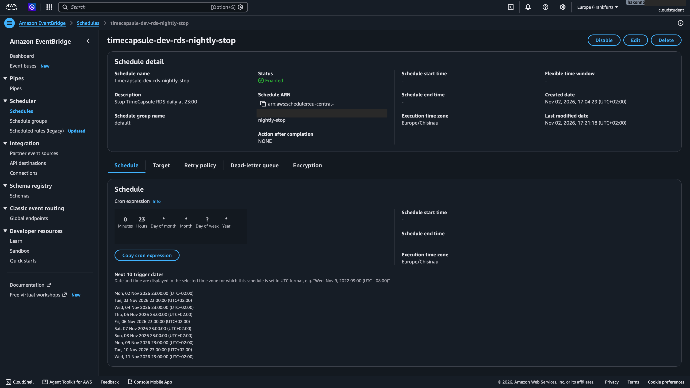

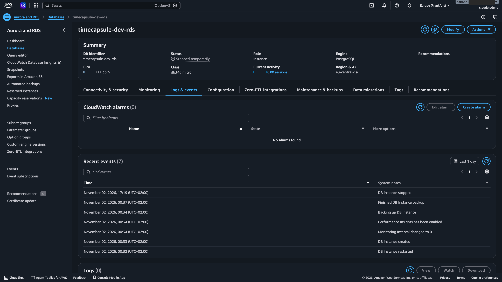

### Задание 8. Пользователь и база данных

К `timecapsule-dev-rds.cr4myc6kwzsa.eu-central-1.rds.amazonaws.com` выполнено подключение под `dbadmin` к служебной базе `postgres`. На момент проверки endpoint разрешался в приватный адрес `10.28.10.172`, порт 5432. Подключение использовало TLS 1.3 (`TLS_AES_256_GCM_SHA384`).

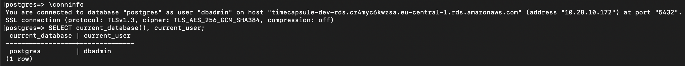

Созданы пользователь и база приложения:

```sql
CREATE USER timecapsule;
\password timecapsule
GRANT timecapsule TO dbadmin;
CREATE DATABASE timecapsule OWNER timecapsule;
```

Пароль задан интерактивно через `\password`; в отчёт и команды SQL открытым текстом он не включён. Запрос к `pg_database` подтвердил владельца `timecapsule` для базы `timecapsule`. Проверка `pg_has_role('dbadmin', 'timecapsule', 'MEMBER')` вернула `t`.

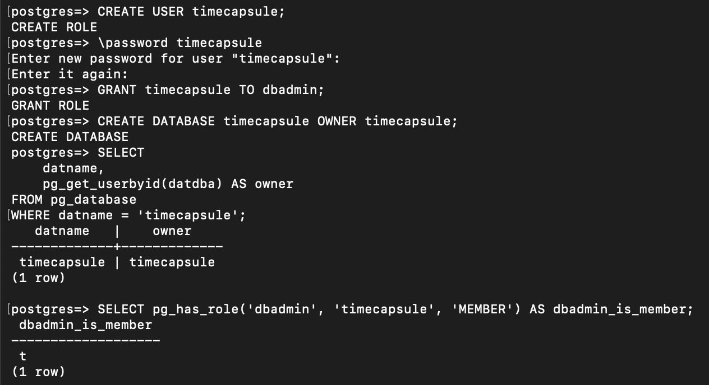

Проверено отдельное подключение к RDS с пользователем `timecapsule`: `current_database()` и `current_user` вернули `timecapsule`. Соединение использует TLS 1.3. Команда `\dt` вернула `Did not find any relations.`: пользовательские таблицы ещё не перенесены.

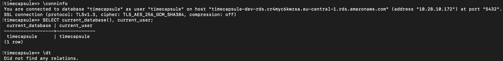

**Почему отдельный пользователь?** Приложение работает с учётной записью владельца своей базы. Административная учётная запись `dbadmin` используется для настройки экземпляра и управления ролями; её пароль приложению не передаётся.

### Задание 9. Перенос данных

На время выгрузки и сверки nginx и PHP-FPM остановлены: обычные страницы приложения могут открывать созревшие капсулы и создавать уведомления. Клиентские утилиты и обе СУБД — PostgreSQL 16.15. Перед восстановлением проверено отсутствие таблиц в целевой базе RDS.

Создан логический архив CUSTOM утилитой `pg_dump`, затем выполнен `pg_restore` под пользователем `timecapsule` с `--no-owner --no-acl --single-transaction`. Обе операции завершились с кодом 0. CUSTOM выбран вместо plain SQL; данные, sequences, индексы и ограничения перенесены.

| Проверка в момент миграции | Исходная EC2 | RDS |
| --- | ---: | ---: |
| users | 2 | 2 |
| capsules | 3 | 3 |
| notifications | 6 | 6 |
| capsules_id_seq, last_value | 8 | 8 |
| notifications_id_seq, last_value | 13 | 13 |
| users_id_seq, last_value | 2 | 2 |

Агрегированные MD5 содержимого таблиц совпали; результат сверки — `MATCH`. Владельцем трёх public tables на RDS является `timecapsule`. Это сверка на момент миграции; после запуска приложение продолжает изменять данные.

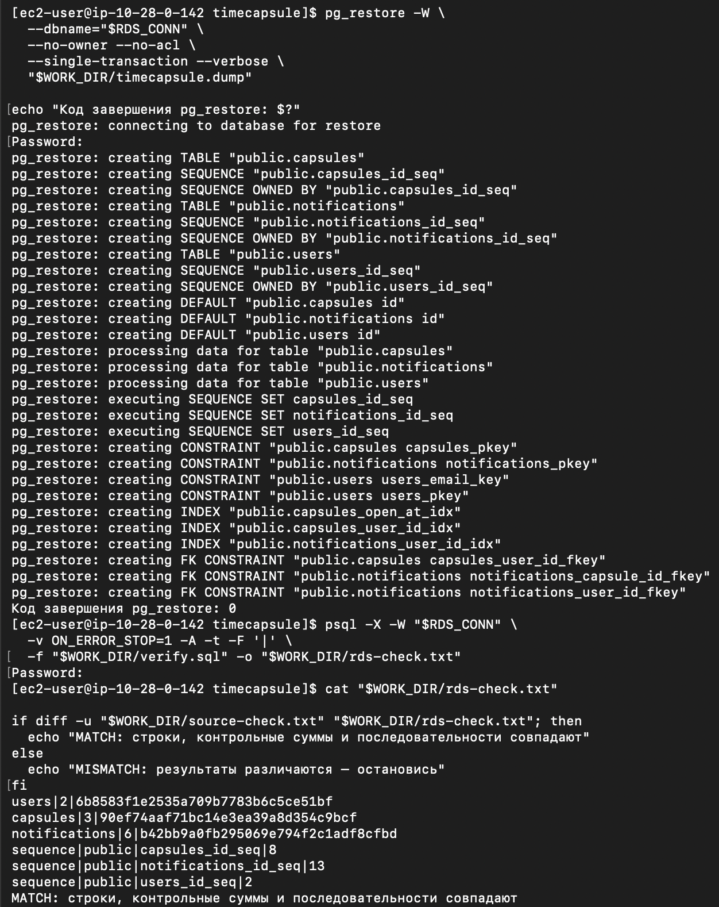

Дамп и результаты сверки скопированы на Mac; SHA-256 локальной и серверной копий совпал. Права каталога 700, файлов 600. Временные файлы выгрузки на сервере удалены, локальная резервная копия сохранена вне Git; сам архив с пользовательскими данными в репозиторий не включён.

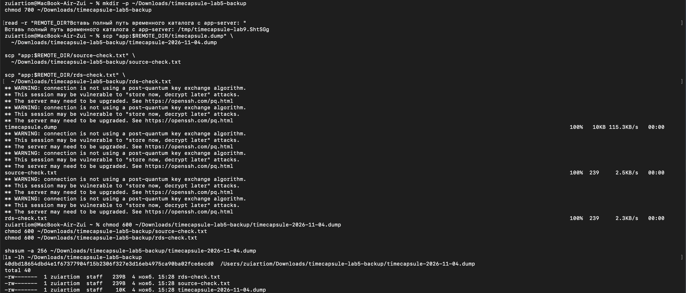

### Задание 10. Переключение приложения

Приватная A-запись `db.timecapsule.internal` заменена CNAME на endpoint `timecapsule-dev-rds.cr4myc6kwzsa.eu-central-1.rds.amazonaws.com`, TTL 60. В runtime-конфигурации сохранены `DB_HOST=db.timecapsule.internal`, база и пользователь `timecapsule`; добавлен `DB_SSLMODE=require`. В PDO DSN добавлен параметр `sslmode` из конфигурации.

Проверка через функцию приложения `db()` подтвердила подключение к RDS и TLS 1.3 (`TLS_AES_256_GCM_SHA384`). `require` требует шифрования, но не означает проверку имени сервера как в `verify-full`. Синтаксис PHP и конфигурация nginx проверены, службы запущены, `/health` вернул 200.

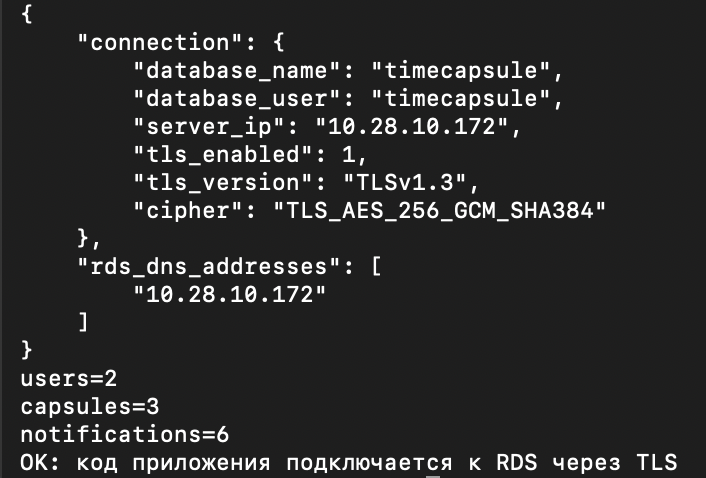

Через сайт создана капсула `RDS-LAB10-20261104`. SQL непосредственно на RDS подтвердил `id=9`, `user_id=2` и одно связанное уведомление. После остановки прежнего db-server приложение продолжило работать; затем старый экземпляр `timecapsule-dev-db` окончательно переведён в `Terminated`.

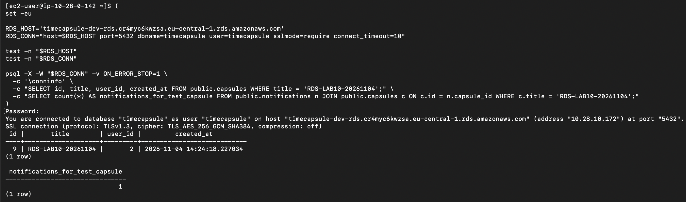

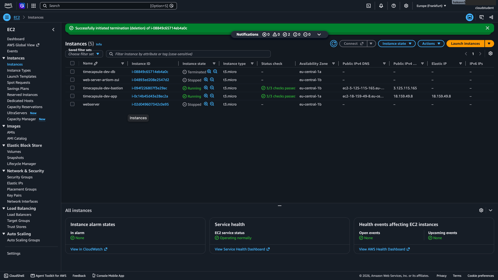

**Зачем CNAME вместо IP?** Endpoint RDS скрывает смену IP при обслуживании. CNAME сохраняет для приложения собственное имя, а при восстановлении в новом экземпляре достаточно заменить его целевое DNS-имя; IP в конфигурацию не записывается.

### Задание 11. Обслуживание базы

Перед корректным экспериментом обнаружено расхождение с результатом задания 10: DNS снова возвращал A-запись старого EC2 `10.28.10.228`, PHP получал тайм-аут подключения к этому адресу. Причина появления записи не установлена. После её замены на CNAME RDS `/health` восстановился до 200; эти ранние ошибки не включены в измерение перезагрузки RDS.

При повторном Reboot после исправления DNS зафиксирован переход `200 → 500 → 200`. Первый ошибочный опрос начат в `17:26:23 UTC`, последний — в `17:26:32`, первый успешный после сбоя — в `17:26:35`: примерно 12 секунд между первым ошибочным и следующим успешным опросом, а не точное измерение длительности простоя. После перезагрузки приложение восстановило соединение.

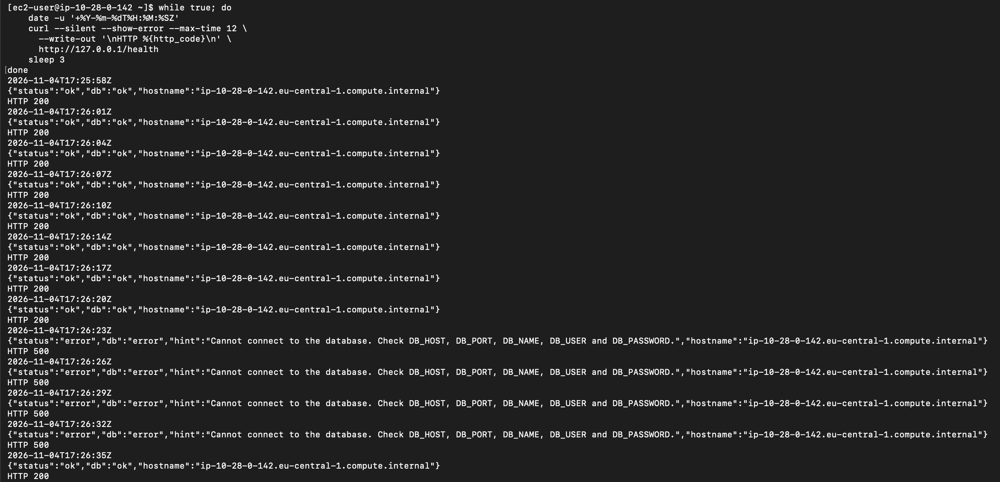

После Stop `/health` вернул `HTTP 500`, `db: error`. Главная страница показала `500 — Something went wrong` и подсказку `Cannot connect to the database`. После Start сайт снова открылся, `/health` вернул `HTTP 200`, `db: ok`.

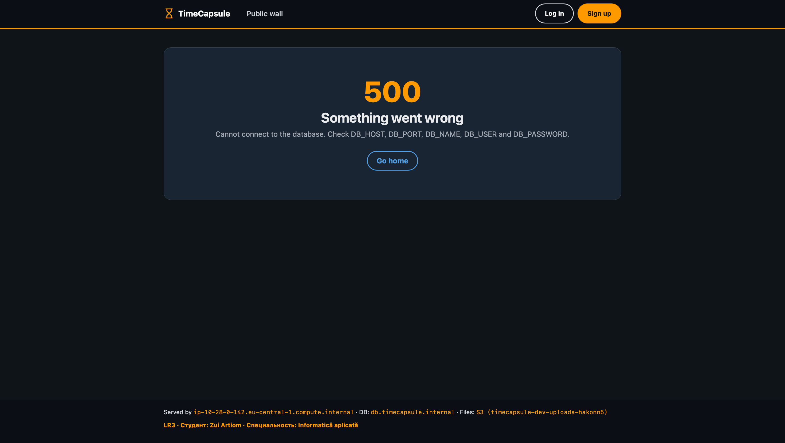

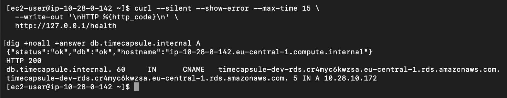

В Events экземпляра за 04.11.2026 видны shutdown/restart в 19:26, завершение остановки в 19:34 и запуск в 20:03 (UTC+02:00). В CloudTrail найден успешный ручной `StopDBInstance` от `cloudstudent` в 19:28:10 (UTC+02:00), источник `rds.amazonaws.com`, ресурс `timecapsule-dev-rds`. Время вызова API отличается от времени завершения остановки.

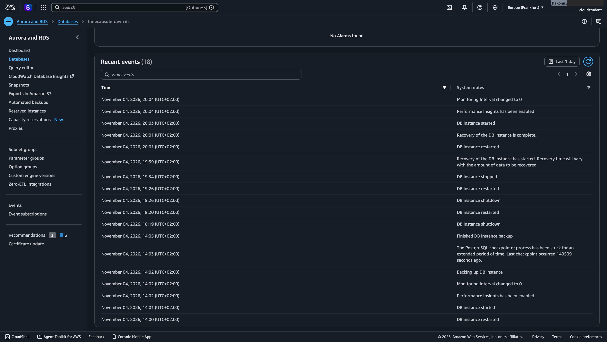

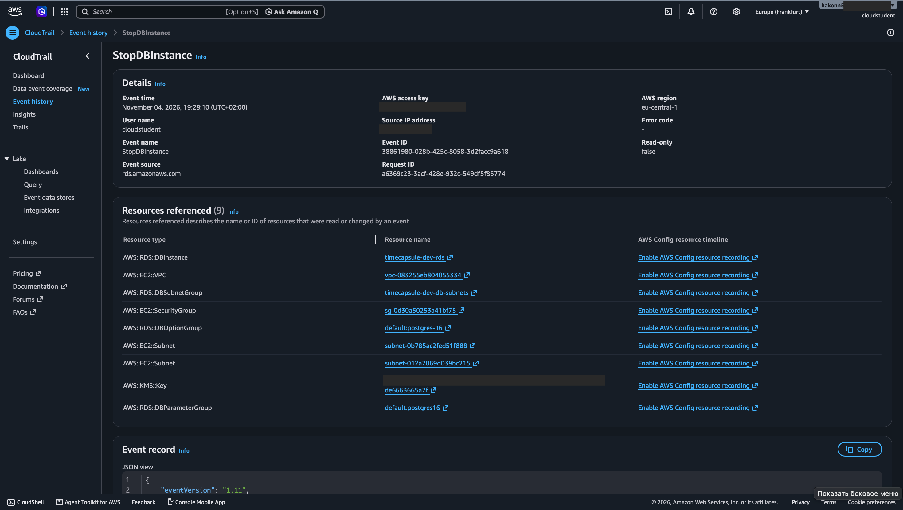

**Изменился ли endpoint?** После Stop/Start сохранились имя endpoint и наблюдаемый IP `10.28.10.172`. В общем случае IP может измениться; приложение продолжает использовать DNS.

**Если расписание вызывает Stop для уже остановленной базы?** API возвращает `InvalidDBInstanceState`. Это документированное поведение [StopDBInstance](https://docs.aws.amazon.com/AmazonRDS/latest/APIReference/API_StopDBInstance.html); отдельно в эксперименте оно не воспроизводилось, а показанное событие CloudTrail относится к ручной успешной остановке.

### Задание 12. Архитектура и решение

Схема обновлена на основе ЛР4 по структуре рисунка 5.1: EC2 db-server заменён приватной RDS Single-AZ, показаны две подсети DB subnet group, TCP 5432 с TLS от приложения, CNAME, EventBridge Scheduler и execution role. Сохранены существующие S3, роль приложения, HTTP-доступ и SSH через bastion. Реплика и PITR-копия Части 1 удалены и в постоянной архитектуре не показаны.

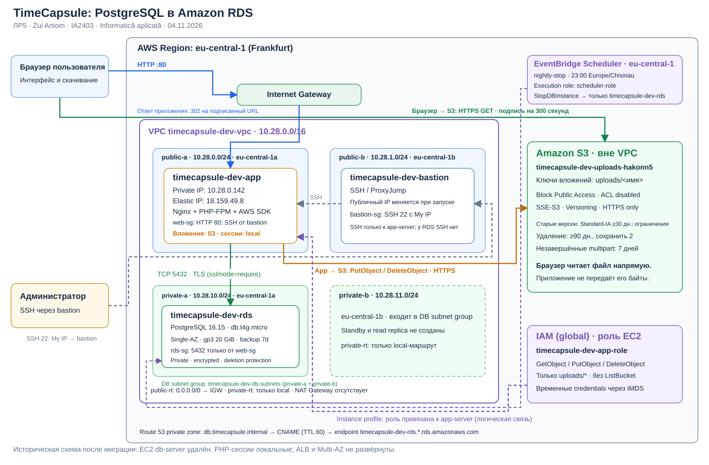

Решение записано в [ADR-0004: размещение базы](../adr/0004-database-hosting.md) по структуре ADR проекта. Сравнены EC2 PostgreSQL, RDS Single-AZ, RDS Multi-AZ с одним standby и Aurora; описаны резервные копии и RPO, расходы и автозапуск через семь суток, DNS и отказ зоны `eu-central-1a`. ADR-0002 сохраняется как история предыдущего решения.

Для учебной нагрузки выбран Single-AZ: управляемые backups и обслуживание при небольшом бюджете, с допустимым простоем. Важное ограничение текущего расписания: остановка в 23:00 Europe/Chisinau перекрывает окно backup 00:56–01:26 UTC. Для ежедневной свежей автоматической копии окно нужно согласовать с периодом работы базы; настройки AWS в рамках оформления не изменялись.

## 3. Завершение работы

Часть 1 завершена, временные ресурсы `lab5-` удалены. Последняя проверка Части 2 после Start: сайт работает, `/health` 200. По условию после занятия базу следует остановить, остальные постоянные ресурсы сохранить для следующих работ; выполнение этой финальной остановки пока не зафиксировано. Отдельная последующая очистка платной инфраструктуры требует свежей локальной копии данных и вложений и не считается выполненной по этому отчёту.

## 4. Выводы по базовой части

Размещена приватная PostgreSQL в Amazon RDS с доступом от Security Group сервера приложения. Проверены зашифрованное подключение, работа реплики для чтения в другой зоне и распространение изменений основной базы на реплику.

Случайное удаление данных распространилось на реплику, поэтому для восстановления использован PITR. В отдельном экземпляре возвращены все четыре строки на момент до удаления; после проверки временная копия удалена. Различие между репликацией и резервным копированием подтверждено практическими результатами.

## 5. Вопросы для защиты продвинутого уровня

1. **Путь запроса.** Браузер обращается по HTTP 80 к Elastic IP app-server через Internet Gateway и Security Group веб-сервера; nginx передаёт PHP-запрос в PHP-FPM. PHP разрешает приватное имя БД через Route 53 и подключается к RDS по TCP 5432 с TLS: RDS SG разрешает источник web-sg, PostgreSQL проверяет пользователя и права на базу. Вложения выдаются через подписанный HTTPS URL в S3; HTTP-интерфейс сайта пока не защищён TLS.
2. **Репликация и backup.** Реплика получает изменения, включая ошибочный DELETE, поэтому не заменяет историю восстановления. Backup и журнал транзакций позволяют выбрать момент до ошибки; в Части 1 это проверено PITR с возвратом четырёх строк в отдельный экземпляр.
3. **Отказ зоны.** Текущий Single-AZ экземпляр не имеет standby; потребуется восстановление в другой зоне, смена CNAME и перенос app-server, который тоже находится в eu-central-1a. Для автоматического переключения БД нужен Multi-AZ, а для доступности сайта — ещё приложение в нескольких зонах и балансировщик. Расходы возрастут на резервную БД, дополнительный app-server и балансировщик; учебная оценка текущей БД — около 4,31 USD/месяц при 3 часах работы в день, без налогов и других сервисов, подробности и ограничения расчёта в ADR-0004.
4. **Автозапуск через семь дней.** EventBridge Scheduler ежедневно в 23:00 Europe/Chisinau вызывает StopDBInstance с ролью, ограниченной одной базой. После автоматического запуска AWS база работает до следующего успешного вечернего вызова, поэтому расписание ограничивает расходы на вычисления, но не гарантирует их отсутствие. Storage и применимые backups оплачиваются и при остановке; Budget является уведомлением.
